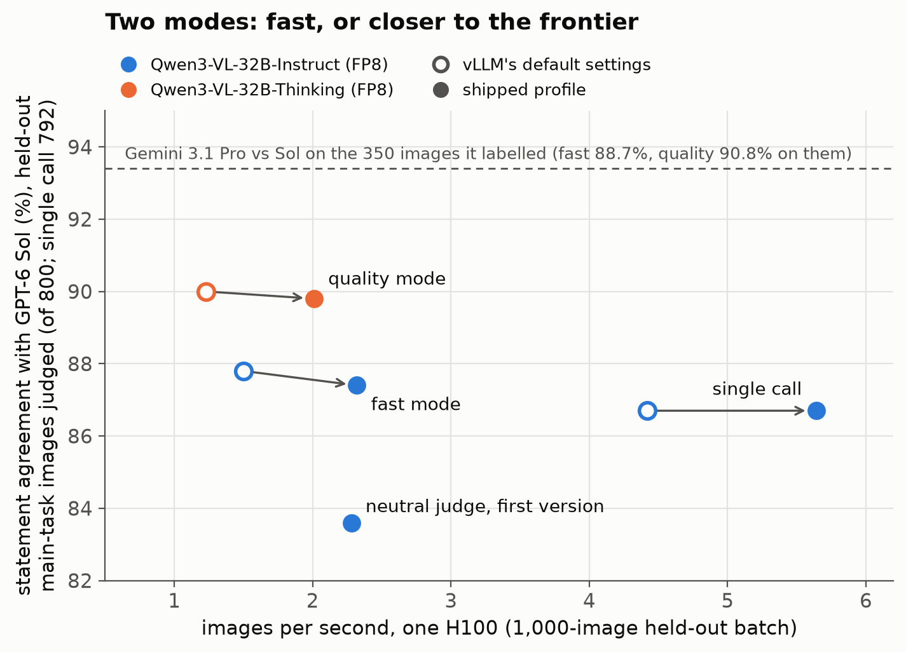
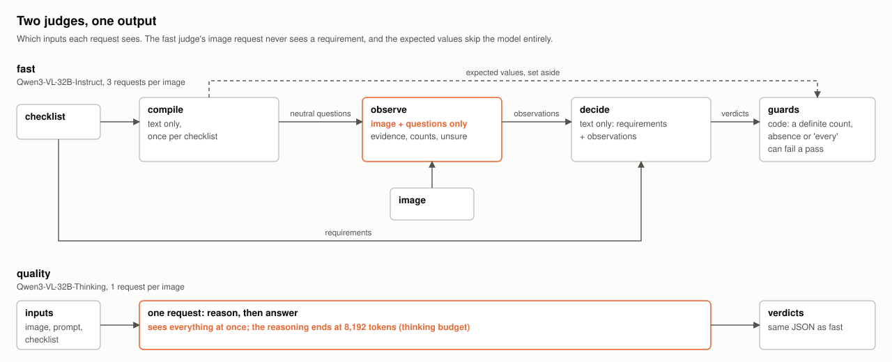
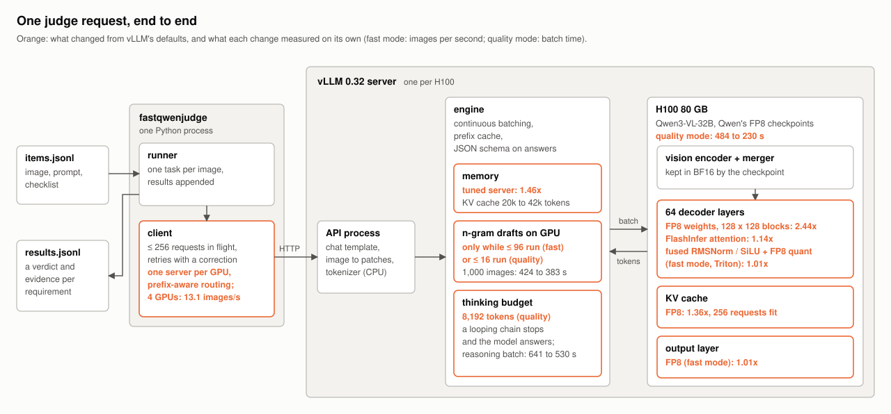
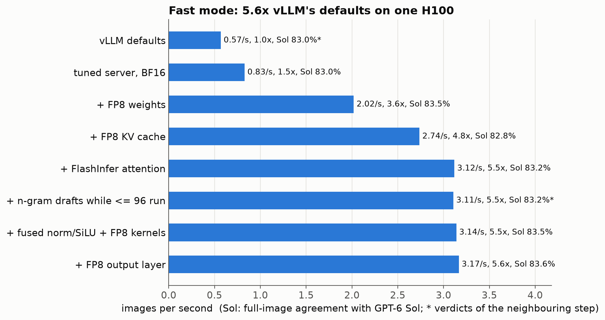
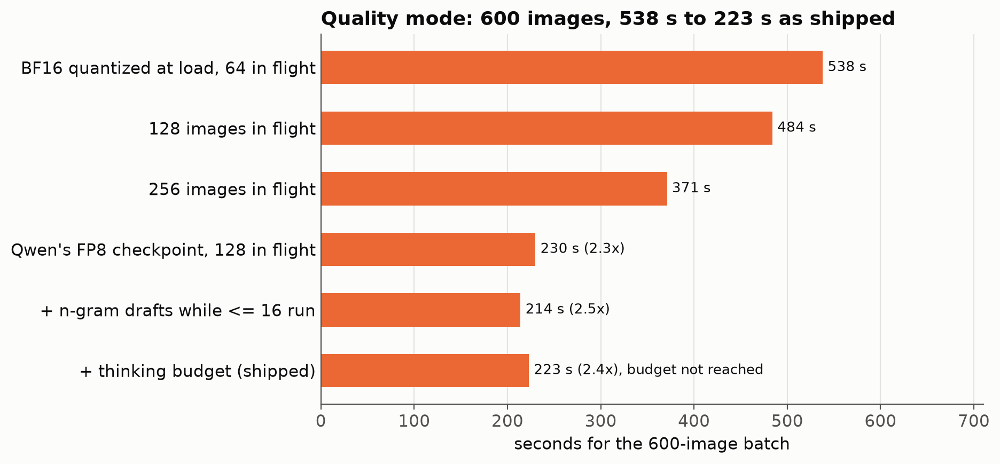

# FastQwenJudge

Checklist judging of generated images with Qwen3-VL-32B on your own GPUs. You give it an image, the prompt it came
from and a list of requirements; it returns a verdict and a line of evidence for every requirement.

It exists because judging thousands of images against checklists is something a research group does every day,
and the two usual options are both bad. A frontier API judge is accurate but costs dollars per thousand images and
returns a batch in minutes to hours. A local VLM asked "is each requirement satisfied?" in one request is cheap
but lenient: it tends to see what the requirement tells it to look for. FastQwenJudge is a local judge that stays
close to the frontier judges (GPT-6 Sol, Gemini 3.1 Pro, and a blind audit by Claude Opus 5.5), served as fast as
I could make it run on an H100.



## Two modes

| | `fast` | `quality` |
|---|---|---|
| Model | Qwen3-VL-32B-Instruct, FP8 | Qwen3-VL-32B-Thinking, FP8 |
| How it judges | neutral grounding: three short requests, and the one that sees the image never sees the requirements | one request; the model reasons (up to 8,192 tokens), then answers |
| 1,000 images on one H100 | 431 s (2.32 images/s) | 497 s (2.01 images/s) |
| The same on vLLM's default settings | 665 s | 815 s |
| One image alone (mean of 30) | 10.6 s | 8.7 s |
| Cost per 1,000 images ($3/H100-hour) | $0.36 | $0.41 |
| Statement agreement with GPT-6 Sol | 87.7% | 89.8% |
| Full-image agreement with GPT-6 Sol | 81.0% | 82.2% |
| Statement agreement with Gemini 3.1 Pro | 88.2% | 90.6% |
| Statement agreement with the Claude Opus 5.5 audit | 84.8% | 83.8% |
| Prompts that need reasoning: statement agreement with Sol | 74.5% | 81.4% |
| Leniency: full-image pass rate minus Sol's | +3.4 points | +13.5 points |

The batch rows are 1,000 images that no part of the judge was tuned on, judged as one batch: 800 main-task images
(FLUX-pool prompts, OpenGPT relation prompts, DiffusionDB, and five benchmarks) and 200 prompts that need reasoning
(R2I-Bench and T2I-CoReBench). Each mode ran with its default settings (256 requests in flight for `fast`, 128 for
`quality`); the row below it is the same checkpoint and requests on vLLM's default server settings, with only the
flags needed to start (and, for `quality`, to parse the reasoning), and agreement within half a point of the shipped
profiles. The agreement rows come from the pre-registered held-out run, where `fast` ran at 128 in flight with a
fixed output limit and left 6 of the 800 main-task images (checklists of 24-50 statements) without a verdict; as it
ships it judges 799 of them, at 87.4% statement agreement with Sol, and on the 794 both runs judged its agreement
moved by -0.2 points [-0.7, +0.3] (see Limitations). The rows are on the main-task images (Gemini labels 350 of
them, the audit 130), except the reasoning row, which is on the 200. "One image alone" is the mean over 30
development images judged one at a time (the quality mode without the thinking budget). For reference, on the 350
images Gemini labelled it agrees with Sol on 93.4% of statements, where the modes reach 89.0% and 90.8% ([how close,
corrected for chance](docs/results.md#the-two-modes-on-the-round-3-held-out-set)); the audit agrees with Sol on
89.6%, and the two API judges cost $5.51 and $5.84 per 1,000 of these images at batch prices: 13-16x the local
modes. Their batch APIs returned these labels in 5-13 minutes per batch (the fast mode takes 7.2 for all 1,000);
batch turnaround depends on the provider's queue, and both promise only 24 hours.

Pick `fast` for large sweeps and for RL rewards (it is the least lenient, so a policy has less to exploit). Pick
`quality` for the numbers you report, and for prompts that need reasoning. Both take the same input and write the
same output.

**Prompts that need reasoning.** Across all 1,047 reasoning images with labels (R2I-Bench and T2I-CoReBench's
reasoning dimensions; 847 of them development images for the fast mode), the quality mode agrees with Sol on 81.7%
of statements against 72.3% (+9.3 [+8.0, +10.7]), with Gemini on 79.9% against 68.3% (582 images), and with the
audit on 78.8% against 73.6% (153). Across all of them it is also the less lenient mode (+6.5 points against
+8.4), though not on the 200 held-out ones (+6.0 against +4.5), and it takes 1.5x the fast mode's time (530 s
against 361 s for 847 images, both at 128 in flight). The lead comes almost entirely from R2I-Bench; details and
caveats in [docs/results.md](docs/results.md#prompts-that-need-reasoning-every-labelled-image).

**The thinking budget.** The quality mode stops the model's reasoning at 8,192 tokens and has it answer from what it
has. Main-task prompts never get near that (the longest reasoning we saw was 5,287 tokens); on prompts that need
reasoning, about 0.6% of chains loop. Without the budget those chains run to the 16,384-token limit, fail, and are
retried, and the batch waits for them: on 847 reasoning images the budget cut 0.7% of chains and took the batch from
641 s to 530 s with statement agreement unchanged. If you judge mostly reasoning prompts and can spend the time,
`--thinking-budget 16384` (or `-1` for none) lets the model think longer; on our reasoning images that changed
statement agreement by nothing and full-image agreement by +0.4 points (not significant), for about 20% more batch
time. [docs/serving.md](docs/serving.md#reasoning-prompts-and-the-thinking-budget) has the measurements.

## Quickstart

Requirements: an 80 GB H100 (both checkpoints are FP8), CUDA 12, Python 3.10+.

```bash
pip install vllm==0.32.0
pip install -e .
```

Try it on the four images in [examples/](examples):

```bash
fastqwenjudge judge --data examples/items.jsonl --out results.jsonl                   # fast mode
fastqwenjudge judge --mode quality --data examples/items.jsonl --out results.jsonl    # quality mode
```

Each command starts a vLLM server with the mode's settings, judges the batch, writes `results.jsonl` and stops
the server. The first run downloads the model (about 34 GB) and compiles kernels, which takes a few minutes; later
starts take about two. On a machine without internet access, download the checkpoint elsewhere and pass its
folder with `--model /path/to/Qwen3-VL-32B-Instruct-FP8` (or `-Thinking-FP8` for the quality mode).

```bash
fastqwenjudge judge --gpus 0,1,2,3 --data items.jsonl --out results.jsonl     # one server per GPU
fastqwenjudge serve --mode fast --port 8000                                   # keep a server up between runs ...
fastqwenjudge judge --base-url http://127.0.0.1:8000/v1 --data items.jsonl --out results.jsonl   # ... and use it
fastqwenjudge judge --mode quality --thinking-budget -1 --data items.jsonl --out results.jsonl  # no budget
fastqwenjudge compare --reference reference.jsonl results.jsonl              # agreement with another judge
```

From Python:

```python
import fastqwenjudge

results = fastqwenjudge.judge("examples/items.jsonl", "results.jsonl", mode="quality")
for image_id, r in results.items():
    print(image_id, r["all_satisfied"], [it["satisfied"] for it in r["items"]])
```

`judge()` takes the command's main options (`base_url=`, `gpus=`, `model=`, `thinking_budget=`). Results are
appended to the output file as they finish, so an interrupted run picks up where it stopped; write to a new file
when you change the mode or the budget.

## Input and output

**Input** is a JSONL file, one image per line ([examples/items.jsonl](examples/items.jsonl)):

```json
{"id": "motorcycles_and_dogs", "prompt": "seven motorcycles and three dogs",
 "image": "images/motorcycles_and_dogs.jpg",
 "requirements": ["There are exactly seven motorcycles in the image.", "The image contains one or more motorcycles.",
                  "There are exactly three dogs in the image.", "The image contains one or more dogs."],
 "group": "counting"}
```

| Field | | |
|---|---|---|
| `id` | required | unique within the file |
| `prompt` | required | the text the image was generated from |
| `image` | required | PNG or JPEG, path relative to the JSONL file |
| `requirements` | required | statements, not questions ("The sofa is red.", not "Is the sofa red?") |
| `group`, `variant` | optional | free-form labels kept with the item (benchmark, model, seed); `--groups` filters on `group` |

Images that share a checklist (the same prompt rendered by different models or seeds) share one compile request
in the fast mode, so judging many renders of one prompt is cheap.

**Output** is a JSONL file, one line per image (the quality mode's verdict on the first example; the fast mode
counted five motorcycles where this run counted seven, which is why both outputs are in [examples/](examples)):

```json
{"key": "15f6ac4690ae12c7", "id": "motorcycles_and_dogs", "judge": "think",
 "result": {"items": [
    {"id": 1, "requirement": "There are exactly seven motorcycles in the image.", "evidence": "The image contains seven distinct motorcycles.", "satisfied": true},
    {"id": 2, "requirement": "The image contains one or more motorcycles.", "evidence": "The image contains seven motorcycles, which is one or more.", "satisfied": true},
    {"id": 3, "requirement": "There are exactly three dogs in the image.", "evidence": "The image contains only one dog, not three.", "satisfied": false},
    {"id": 4, "requirement": "The image contains one or more dogs.", "evidence": "The image contains one dog, which is one or more.", "satisfied": true}],
  "score": 0.75, "all_satisfied": false, "requests": 1}}
```

Each line has the image `id`, the `judge` that produced it, a `key` the runner uses to resume, and the `result`.
`items` has one entry per requirement, in input order: the `requirement`, the model's `evidence`, and `satisfied`.
`score` is the fraction satisfied and `all_satisfied` whether all are. The fast mode also keeps `plans` (the
neutral question asked for each requirement and the expected value set aside), `observations` (what the model
reported seeing) and `text_verdict_before_guards`, so any verdict can be traced back to what the model saw; the
quality mode keeps `requests` (attempts needed). An image that failed after three attempts has an `error` field
instead of `result` and is retried on the next run. [examples/](examples) has both modes' full output for the
four example images.

`compare` reads any file in this format as the reference (an API judge's labels, a human audit), matched by `id`.

## How it works



**Fast mode: neutral grounding.** A judge that reads "three red apples" and then looks at the image tends to see
three red apples. The neutral judge splits the decision so that the request that looks at the image never sees
the desired answer. A text-only *compile* step turns each requirement into a neutral question and keeps the
expected value aside ("There are exactly three cups" becomes "Describe the cups on the table", expected count 3).
An *observe* step answers those questions from the image alone. A text-only *decide* step compares requirements
with observations, and a few lines of code veto a pass that a definite observation contradicts (a stated count,
an absence, "every X"). Details in [docs/design.md](docs/design.md).

**Quality mode: a thinking model in one call.** The Thinking variant reasons before it answers. On the same images
it is about 2 points closer to Sol and Gemini on the main task (a point further from the blind audit) and 7 points
closer to Sol on prompts that need reasoning, at 1.2x the fast mode's time per batch. It is also more lenient, which
matters if its verdicts become a reward.

**Serving.** Both modes run on vLLM with Qwen's FP8 checkpoints, an FP8 KV cache, FlashInfer attention, and n-gram
speculative decoding switched on only when the batch is small enough for it to pay. The fast mode adds fused
RMSNorm/SiLU + FP8 quantization kernels for Qwen3-VL's decoder layers, loaded as a vLLM plugin; the quality mode
adds the thinking budget. Every change was measured on its own, and agreement was re-checked after each change
that can move verdicts:







The quality mode's biggest win was not a kernel. Qwen's FP8 checkpoint (128x128 weight blocks, the vision tower kept
in BF16) writes 20% fewer tokens than the BF16 weights quantized at load, and shortens the tail of long reasoning
chains that decides when a batch finishes. [docs/serving.md](docs/serving.md) covers profiling, both ladders,
scale-out, RL-sized batches, reasoning length, and what speculative decoding can and cannot do for reasoning chains.

## How we know it agrees with the frontier judges

Three references, none of them used to train anything: GPT-6 Sol (reasoning effort xhigh) on every evaluation
image, Gemini 3.1 Pro on a subset, and a blind audit in which Claude Opus 5.5 graded random images by looking at
them, before any judge output on them existed. The judge was changed in rounds. Each round's rules were written
down before its held-out data existed, decisions were made on development sets only, and each held-out set was
used once. The round-2 neutral judge beat the first version by 2.8 statement points against Sol on round 2's
held-out set and by 4.1 on round 3's (+5.3 against the audit). Five further changes tried in round 3 left
main-task agreement with Sol within half a point on development and held-out data and were not adopted; the one
pre-registered for reasoning prompts did not hold on the held-out set. The quality mode was a pre-registered
hypothesis that held on round 3's held-out set. As it ships, it keeps the gain against Sol, but against the audit
it is a point below the fast mode on the main task (within noise). [docs/results.md](docs/results.md) has the
per-set tables and what did not work.

## Using it for RL rewards

An RL step waits for the last reward of its batch, so a batch of 16-64 images is mostly tail, where drafting
tokens pays off more than in a 1,000-image batch: n-gram drafts take the quality mode's 64-image step from 75 s to
60 s. For the fast mode they help on in-family prompts and hurt on new prompt styles from 32 images up
([docs/serving.md](docs/serving.md#rl-sized-batches)).

| Time until the last verdict, one H100 | 16 images | 64 images |
|---|---|---|
| fast mode (n-gram drafts; mean of 3 runs on two image sets) | 23-24 s | 44-59 s |
| quality mode, `quality_rl` profile (median of 4-6 batches; worst in brackets) | 24 s (33 s) | 54 s (80 s) |
| quality mode without drafts or budget | 42 s (46 s) | 75 s (96 s) |

`--server quality_rl` is the quality profile with n-gram drafts at every batch size. The thinking budget bounds
the worst step: without it, one looping chain held a 64-image step for 145 s.

## Limitations

- Both modes see one image per request. Editing tasks with a source and a result image are not supported yet.
- Agreement is measured on text-to-image outputs with checklists of statements; other image types are untested.
- The thinking model samples (temperature 0.6, fixed seed per request), so rerunning the quality mode can change
  a small share of verdicts; the fast mode is greedy, but batching still flips about 1% of its statement verdicts.
- The reasoning-prompt numbers in the table come from 200 held-out images, 30 of them audited; on those 30 the
  audit sides with the fast mode (4.0 statement points; the quality mode passes six of them in full that the audit
  fails). The larger 1,047-image comparison, where the audit sides with the quality mode, includes the fast mode's
  development images.
- The quality mode is lenient: it passes 13.5 points more images in full than Sol does.
- The fast mode left 2 of the 1,000 held-out images without a verdict (an `error` field instead of a result): one
  whose plan kept failing the check that a neutral question does not name the expected count, and one 32-statement
  checklist whose observations ran past their output limit (128 tokens per statement) on every attempt. With the
  earlier fixed limit of 2,048 tokens, 6 more checklists of 24-50 statements got no verdict; judging them in full
  made the batch 11% slower ([docs/serving.md](docs/serving.md#long-checklists)). The quality mode judged every image.
- vLLM's compile cache is off in the fast profile, because it does not know about the patched decoder layers;
  start-up takes about a minute longer.

## Follow-ups

- The quality mode on 2 and 4 GPUs. The fast mode reaches 13.1 images/s on 4 with independent replicas and
  prefix-aware routing; the quality mode should scale the same way, but it has not been measured.
- A trained drafter (EAGLE-3, DFlash or DSpark) for the Thinking model, and GPU suffix decoding once vLLM ships it.
- Two-image (editing) inputs.

## Repository

| Path | What it is |
|---|---|
| `src/fastqwenjudge/` | the package: `judge()` and the `fastqwenjudge` command (`modes.py`, `cli.py`) |
| `src/fastqwenjudge/judges/` | `neutral.py` (fast mode, with the guards), `single.py` (quality mode and single-call baselines), `vqascore.py` (baseline) |
| `src/fastqwenjudge/client.py`, `runner.py` | async client (requests in flight, retries, prefix-aware routing) and the resumable runner |
| `src/fastqwenjudge/server.py`, `profiles/` | starts vLLM from a profile; `fast`, `quality`, `quality_rl` |
| `src/fastqwenjudge/kernels/` | fused RMSNorm/SiLU + FP8 Triton kernels and the vLLM plugin that loads them (`FQJ_FUSED_KERNELS=1`) |
| `src/fastqwenjudge/prompts/` | every system prompt, as plain text |
| `examples/` | four images, their items file, and both modes' output |
| `configs/servers/` | vLLM as it comes (`default.yaml`) and the tuned BF16 and FP8 profiles of the serving ladder's first steps |
| `experiments/quality/` | `run.py` runs judges on one server; `analyze.py` builds the agreement tables |
| `experiments/throughput/` | `sweep.py` (latency against load), `makespan.py` (time to the last verdict of a batch), `run.py`, `efficiency.py` (MFU, MBU), `startup.py`, `hf_server.py` (transformers baseline), `plot.py` |
| `experiments/kernels/` | `profile_server.py` (GPU time by kernel under load), kernel benchmarks (`bench_*.py`), the block-FP8 GEMM that was not adopted |
| `experiments/speculator/` | training data and hidden states for the EAGLE-3 draft head |
| `experiments/audit/` | building a blind audit queue, recording verdicts, scoring judges against it |
| `experiments/ladder.py` | the serving ladder table, [docs/ladder.md](docs/ladder.md) |
| `docs/` | [design](docs/design.md), [results](docs/results.md), [serving](docs/serving.md), [audit protocol](docs/audit.md) |

The experiment scripts read item files from `data/` and write per-image outputs into `results/` folders. Neither
is in the repository (the evaluation images and reference labels add up to about 30 GB); the aggregate tables
they produced, and figures drawn from them, are in `docs/`.

## License

Apache-2.0.
