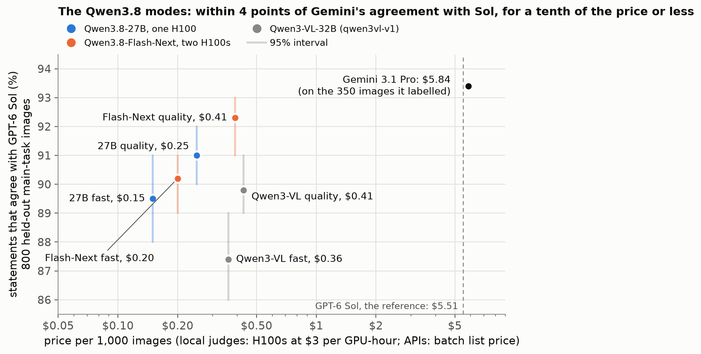

# FastQwenJudge

Checklist judging of generated images with Qwen3.8 on your own GPUs. You give it an image, the prompt it came from
and a list of requirements; it returns a verdict and a line of evidence for every requirement.

It supports my research on image generation rather than being the research itself: it lets me judge each change to
a model against checklists in minutes, instead of paying frontier-API prices for every run. People in my research
group use it for the same kind of work, and it is open source for anyone with GPUs, their own or rented, who wants to
run their own judge.

Judging thousands of images against checklists is routine work for anyone training or evaluating an image generator.
The usual options are an API judge, which is accurate but costs dollars per thousand images, or a local VLM, which is
cheap but lenient: asked in one request whether each requirement holds, it tends to see what the requirement tells it
to look for. FastQwenJudge is a local judge measured against three frontier references (GPT-6 Sol, Gemini 3.1 Pro, and
a blind audit by Claude Opus 5.5) and served as fast as I could make it run on H100s. Its closest mode agrees with Sol
on 92.3% of statements; on the 350 images Gemini also labelled it agrees with Sol on 93.0%, where Gemini and Sol agree
on 93.4%. It costs $0.41 per thousand images, where Sol costs $5.51.



## Four modes

Two models: **Qwen3.8-27B** in Qwen's FP8 checkpoint on one H100, and **Qwen3.8-Flash-Next** (a 125B mixture of
experts, 6B parameters active per token) in NVIDIA's NVFP4 checkpoint on two. Each runs with its thinking off (fast)
or at medium reasoning effort (quality). Every number in the table is from the same 1,000 held-out images (800
main-task, 200 that need reasoning), with settings written down beforehand: agreement from the run of 2026-10-30,
speed and cost from a timing-only run of the package's settings on 2026-10-31. The exception is one image alone: the
mean over 30 development images, one at a time. Brackets are 95% bootstrap intervals.

| | `fast` | `quality` | `flash-fast` | `flash-quality` |
|---|---|---|---|---|
| Model | Qwen3.8-27B, FP8 | Qwen3.8-27B, FP8 | Qwen3.8-Flash-Next, NVFP4 | Qwen3.8-Flash-Next, NVFP4 |
| GPUs | 1 H100 | 1 H100 | 2 H100s | 2 H100s |
| How it judges | thinking off, strict prompt, pass only if P(true) >= 0.999 | medium reasoning, strict prompt | thinking off, plain prompt, pass only if P(true) >= 0.998 | medium reasoning, strict prompt |
| 1,000 images | 177 s (5.64 images/s) | 295 s (3.39 images/s) | 121 s (8.26 images/s) | 249 s (4.02 images/s) |
| One image alone | 1.6 s | 4.0 s | 1.3 s | 3.5 s |
| Cost per 1,000 images ($3 per H100-hour) | $0.15 | $0.25 | $0.20 | $0.41 |
| Generated tokens/s, whole batch (per GPU) | 1,687 | 2,855 | 2,611 (1,306) | 3,506 (1,753) |
| Prompt + generated tokens/s, whole batch (per GPU) | 10,942 | 8,399 | 14,432 (7,216) | 10,048 (5,024) |
| Statements agreeing with GPT-6 Sol, main task (800) | 89.5% [88, 91] | 91.0% [90, 92] | 90.2% [89, 91] | 92.3% [91, 93] |
| Full images agreeing with Sol (pass or fail) | 82.9% | 83.4% | 84.8% | 86.5% |
| Leniency: full-image pass rate minus Sol's | +6.9 points | +11.1 | +2.0 | +4.8 |
| Prompts that need reasoning (200): statements vs Sol | 82.1% [80, 85] | 86.1% [84, 88] | 86.2% [84, 89] | 89.0% [87, 91] |
| Statements agreeing with Gemini 3.1 Pro (350 main-task) | 89.7% | 91.7% | 90.9% | 93.2% |
| Statements agreeing with the Claude Opus 5.5 audit (~130) | 86.9% | 86.1% | 86.2% | 87.7% |

For scale: the two frontier judges agree with each other on 93.4% of statements on the 350 images Gemini labelled, and
the same judge on Qwen3-VL-32B (`qwen3vl-v1`, below) reached 87.4% (fast) and 89.8% (quality) against Sol on the same
800 images, at $0.36 and $0.41 per thousand. Sol costs $5.51 and Gemini $5.84 per thousand images at batch list
prices. Tokens per second count thinking tokens as generated and image tokens as prompt; they compare servers, not
judges, since the modes need 299-872 generated tokens per image (Qwen3-VL-32B's fast mode needed 1,294 for its three
requests per image at 2,999 tokens/s). Per-request decode speed, time to first token, and how each figure is counted:
[docs/serving.md](docs/serving.md#tokens-per-second-and-latency-per-request).

Which to use:

- **`fast`** is the cheapest and fits one GPU; it agrees with Sol as well as Qwen3-VL-32B-Thinking does.
- **`quality`** is the best one-GPU judge, most of all on prompts that need reasoning (a scene after an event, a
  quantity to compute, a rule to apply), and the most lenient of the four.
- **`flash-fast`** is the least lenient: it passes almost exactly as many images in full as Sol does.
- **`flash-quality`** is the closest to the frontier judges on every reference.

The agreement rows are from the run of 2026-10-30, with that day's serving settings (Flash-Next at 64 requests at
once, input order, no thinking budget). The serving changes made after it ([docs/serving.md](docs/serving.md)), each
measured on 600 development images against the previous settings in the same job: Flash-Next in 92% of GPU memory with
96 requests at once took its batches from 91 s to 80-81 s (`flash-fast`) and from 195 s to 150-154 s
(`flash-quality`); starting the longest checklists first then took them to 75 s and 139 s against anchors of 79-81 s
and 156-165 s before and after (the 27B: 104 s against 106-110 s, 171 s against 178-182 s); 112 requests at once took
`flash-fast` from 78 s to 73-75 s. Each moved verdicts about as much as rerunning the same settings does, and so did
all of them together: the timing run's verdicts differ from the 2026-10-30 run's on 3.2-5.6% of statements, as reruns
and the kept changes do on development images (Limitations, below). On the held-out images the changes took Flash-Next
from 154 s to 121 s and 288 s to 249 s, and the 27B from 179 s to 177 s and 301 s to 295 s. The quality modes also cap
reasoning at 8,192 tokens (below).

## Quickstart

What it was measured on: H100 80 GB (SXM) GPUs, vLLM 0.32.0, Python 3.11. The 27B modes need one GPU. The Flash-Next
modes need two, and host memory for the model's 51-billion-parameter n-gram table, which vLLM keeps off the GPU (we
ran with 192 GB).

```bash
pip install vllm==0.32.0
pip install -e .
```

Try it on the four images in [examples/](examples):

```bash
fastqwenjudge judge --mode fast --data examples/items.jsonl --out fast.jsonl                   # one GPU
fastqwenjudge judge --mode quality --data examples/items.jsonl --out quality.jsonl             # one GPU
fastqwenjudge judge --mode flash-fast --data examples/items.jsonl --out flash-fast.jsonl       # two GPUs
fastqwenjudge judge --mode flash-quality --data examples/items.jsonl --out flash-quality.jsonl # two GPUs
```

`examples/results_<mode>.jsonl` are the same command's output for each mode (made on 2026-10-30, before the last
serving changes). A rerun can differ on a few statements: the quality modes sample, and the fast modes' probabilities
can land on either side of their cut-off (Limitations). Write to a new file: an output file that already has an
image's result skips it.

Each command starts a vLLM server with the mode's settings, judges the batch, writes its output file and stops the
server. The first run downloads the checkpoint (31 GB for the 27B, 133 GB for Flash-Next) and compiles kernels;
later starts take about two minutes (four for Flash-Next). On a machine without internet access, download the
checkpoint elsewhere and pass its folder with `--model /path/to/Qwen3.8-27B-FP8`.

```bash
fastqwenjudge judge --gpus 0,1,2,3 --data items.jsonl --out results.jsonl     # one server per GPU (per pair for flash)
fastqwenjudge serve --mode quality --port 8000                                # keep a server up between runs ...
fastqwenjudge judge --mode quality --base-url http://127.0.0.1:8000/v1 --data items.jsonl --out results.jsonl
fastqwenjudge checklist --data prompts.jsonl --out items.jsonl                # requirements from prompts
fastqwenjudge compare --reference reference.jsonl results.jsonl              # agreement with another judge
```

`fast` and `quality` share a server (thinking is switched per request), so one `serve --mode quality` serves both.
`flash-fast` and `flash-quality` share a model but not their server settings: `flash-fast` runs 112 requests at once
and `flash-quality` 96, so start the server with the mode you will judge with. `compare` reads any file in the
output format below as the reference; its items must hold the same requirements in the same order.

From Python:

```python
import fastqwenjudge

results = fastqwenjudge.judge("examples/items.jsonl", "results.jsonl", mode="quality")
for image_id, r in results.items():
    print(image_id, r["all_satisfied"], [it["satisfied"] for it in r["items"]])
```

`judge()` takes the command's main options (`base_url=`, `gpus=` as a list such as `["0", "1"]`, `model=`,
`objective=`). Results are appended to
the output file as they finish, so an interrupted run picks up where it stopped; write to a new file when you change
the mode.

## Input and output

**Input** is a JSONL file, one image per line ([examples/items.jsonl](examples/items.jsonl)):

```json
{"id": "motorcycles_and_dogs", "prompt": "seven motorcycles and three dogs",
 "image": "images/motorcycles_and_dogs.jpg",
 "requirements": ["There are exactly seven motorcycles in the image.", "The image contains one or more motorcycles.",
                  "There are exactly three dogs in the image.", "The image contains one or more dogs."],
 "group": "counting"}
```

| Field | | |
|---|---|---|
| `id` | required | unique within the file |
| `prompt` | required | the text the image was generated from |
| `image` | required | PNG or JPEG, path relative to the JSONL file |
| `requirements` | required | statements, not questions ("The sofa is red.", not "Is the sofa red?") |
| `group`, `variant` | optional | free-form labels kept with the item (benchmark, model, seed); `--groups` filters on `group` |

No checklists yet? `fastqwenjudge checklist` writes them from prompts ([docs/checklists.md](docs/checklists.md)).

**Output** is a JSONL file, one line per image (the `fast` mode on the first example, evidence shortened):

```json
{"key": "8abc8ade85da7182", "id": "motorcycles_and_dogs", "judge": "fast",
 "result": {"items": [
    {"id": 1, "requirement": "There are exactly seven motorcycles in the image.", "evidence": "I can clearly identify four motorcycles in the foreground and mid-ground (...)", "satisfied": false, "p_true": 1.0e-05, "written": false},
    {"id": 2, "requirement": "The image contains one or more motorcycles.", "evidence": "There are multiple motorcycles visible in the image (...)", "satisfied": true, "p_true": 0.999998, "written": true},
    ...],
  "score": 0.5, "all_satisfied": false, "requests": 1}}
```

Each line has the image `id`, the `judge` that produced it, a `key` the runner uses to resume, and the `result`.
`items` has one entry per requirement, in input order: the `requirement`, the model's `evidence`, and `satisfied`.
The fast modes add `p_true`, the probability the model gave the verdict `true`, and `written`, the verdict it wrote:
`satisfied` is `p_true` >= the mode's cut-off, so the two differ where the model was not quite sure. `score` is the
fraction satisfied and `all_satisfied` whether all are. An image that failed after three attempts has an `error`
field instead of `result` and is retried on the next run. [examples/](examples) has all four modes' output for the
four images.

## How it judges

One request per image: the prompt, the numbered checklist and the image, answered as JSON with one verdict and one
line of evidence per requirement (the server's structured output enforces the shape and the count). Three things
make that single call a good judge on these models ([docs/design.md](docs/design.md)):

- **A strict prompt.** The errors left are near misses: a dog that is not quite the named breed, a pose that
  suggests running, a two-part requirement with one part true. The strict prompt spells out that every part of a
  requirement counts, that identities must be visible, and that actions must be shown, not inferred.
- **The model's own confidence, with thinking off.** The verdict is one token, and the server returns its
  probability. Counting a statement as satisfied only when P(true) >= 0.999 took the 27B's leniency on development
  images from +16 to +6 points for 0.8 points of agreement with Sol: the model is sure of almost everything (fewer
  than 2% of its verdicts fall between 0.02 and 0.98), so the useful cut-offs are in the fourth decimal.
- **Reasoning, with thinking on,** at medium effort, capped at 8,192 tokens of reasoning. Normal chains stay well
  under it (it cut one of 27,742 development chains); it is there for the rare chain that loops, which can run toward
  the 32,768-token limit and hold a whole batch open ([docs/serving.md](docs/serving.md#the-batchs-tail)).

A neutral pipeline (three requests, the one that sees the image never sees the requirements), which this judge used on
Qwen3-VL-32B, does not pay on these models: it was 2.6-3.1x slower than one request, agreed less often with Sol and
Gemini (the audit preferred it to the single call with thinking off, by 2.4 points on the 27B and 0.6 on Flash-Next,
but not to the thinking ones), and overcorrected, failing more images than Sol does. A no-checklist baseline, a 0-10
score for how well the image follows its prompt, loses 4 to 14 points of full-image agreement with Sol against the
checklist judges ([docs/results.md](docs/results.md)).

## How fast, and why


The 27B judges 1,000 images with medium reasoning in 295 s on one H100. A floor from an analytic model of the work
(every FLOP at the FP8 tensor-core peak, or every byte at peak HBM bandwidth, whichever binds, every step full) is 80
s, so the run is at 3.7x its speed of light. The GPU is busy 97% of the time, which says little on its own: busy is
not fast. A profile of every kernel of a whole batch, set against what each kernel reaches alone at this model's
shapes, splits the gap. Of a 600-image development batch's gap (3.7x its own speed of light), more than half (53-57%;
the vision tower's kernels were not measured alone) is out of reach for today's kernels at these shapes: a decoding
step of 64 requests x 4 tokens sits at the H100's ridge point, where FP8 matmuls reach about half of peak;
FlashAttention 3 reaches about 40% of the bandwidth for this model's 4 KV heads of 256; and speculative decoding needs
a copy of each DeltaNet state per draft. About a sixth is kernels below their own ceiling, and a quarter is small
kernels outside the model's work and the time between them ([docs/roofline.md](docs/roofline.md)).

What made it fast, each step measured on the same development images: a 16-bit DeltaNet state instead of the
checkpoint's 32-bit one together with a cap of 64 requests at once, which halved the quality judge's batch (369 s to
184 s for 600 images); no prefix caching (every request has its own image); the checkpoint's own draft head (three
draft tokens per step, worth about 40% to the 27B's thinking judge); the output layer in FP8 (a small vLLM plugin,
4%); starting the longest checklists first (4-13%); and, for the 27B's quality judge, a top-k / top-p mask whose cost
does not depend on the logits (a second plugin: 7% more images per second in steady state, within noise on batch
time). For Flash-Next: tensor parallelism across both GPUs with the experts split between them, 92% of GPU memory, and
96-112 requests at once.


How many requests to run at once was measured at a fixed load, not picked: past 64 the 27B gains at most 2% while each
image takes about 1.4x as long; Flash-Next gains 19-24% from 64 to 112, with the time per image growing up to 96 and
barely from 96 to 112. Tried and not kept, with numbers in [docs/serving.md](docs/serving.md): a Triton kernel that
writes the DeltaNet state once a step instead of once per draft token (correct, but 3-6% slower), more draft tokens as
a batch empties, two Flash-Next replicas instead of one across both GPUs, Flash-Next's dense layers in FP8, a top-k /
top-p mask built from the 64 largest logits, and vLLM's fusions of the norms and activations into the FP8
quantization.

## How we know it agrees with the frontier judges

Three references, none of them used to tune anything on the held-out set: GPT-6 Sol (reasoning effort xhigh) on every
image, Gemini 3.1 Pro on a subset, and a blind audit in which Claude Opus 5.5 graded random images by looking at them
before any judge output on them existed. The held-out set was scored twice, each time with the judges and settings
written down beforehand: once for the baselines (which is where the single call replaced the neutral pipeline) and
once for the four modes; a third run, also planned in advance, measured only their speed. Prompts, cut-offs, sampling
and reasoning effort were chosen on development sets in between. The serving changes made after the final run (order,
request caps, the sampling kernel, and the reasoning and answer caps, which bind only on rare runaway requests) were
checked on development images to move verdicts no more than a rerun does. [docs/results.md](docs/results.md) has the
per-set tables, the baselines, and what did not work.

## Limitations

- One image per request: editing tasks with a source and a result image are not supported.
- Agreement is measured on text-to-image outputs with checklists of statements; other image types are untested.
- The quality modes sample (temperature 1.0, a fixed seed per request), and batching changes the arithmetic, so a
  rerun changes about 4-6% of their statement verdicts. The fast modes are greedy, and the verdict the model writes
  changes for about 2% of statements, but many of their probabilities sit near the cut-off, so 2.7-5.0% of their
  final verdicts change (Flash-Next 2.7-3.3%, the 27B 4.0-5.0%).
- `quality` is lenient: it passes 11.1 points more images in full than Sol does. `flash-fast` and `flash-quality`
  are the ones to use when false passes cost more than false fails.
- The Flash-Next modes need two 80 GB GPUs and host memory for the n-gram table.
- The package is pinned to vLLM 0.32 (the Quickstart installs it), whose internals its two 27B plugins (the FP8
  output layer and the three-pass top-k / top-p mask) patch, and every number here was measured on it. Trying another
  version is at your own risk: install it yourself, copy `src/fastqwenjudge/profiles/27b.yaml`, remove its
  `FQJ_FP8_LM_HEAD` and `FQJ_TOPK_TOPP` lines, pass the copy with `--server`, and check verdicts against a 0.32 run.

## Repository

| Path | What it is |
|---|---|
| `src/fastqwenjudge/` | the package: `judge()` and the `fastqwenjudge` command (`modes.py`, `cli.py`) |
| `src/fastqwenjudge/judges/` | `single.py`, the one-request judge behind every mode, and the four modes' settings |
| `src/fastqwenjudge/client.py`, `runner.py` | async client (requests in flight, retries, admission order) and the resumable runner |
| `src/fastqwenjudge/server.py`, `profiles/` | starts vLLM from a profile: `27b`, `flash_next` |
| `src/fastqwenjudge/kernels/` | two vLLM plugins for the 27B: the output layer in block FP8 (`FQJ_FP8_LM_HEAD=1`) and a top-k / top-p mask whose cost does not depend on the logits (`FQJ_TOPK_TOPP=1`) |
| `src/fastqwenjudge/checklists.py`, `prompts/` | checklist generation; every system prompt, as plain text |
| `examples/` | four images, their items file, and the four modes' output |
| `experiments/qwen38/` | `run.py` (judges on one server), `ladder.py` (serving settings one after another), `profile_gpu.py` (GPU time by kernel), `nsys_summary.py` (a whole batch's kernels), `ceilings.py` (what each kernel class reaches at the model's shapes), `roofline.py` (MFU, MBU, speed of light); every ladder's settings in `ladders/` |
| `experiments/audit/` | building a blind audit queue and recording its verdicts |
| `docs/` | [design](docs/design.md), [results](docs/results.md), [serving](docs/serving.md), [roofline](docs/roofline.md), [checklists](docs/checklists.md), [audit protocol](docs/audit.md) |

The experiment scripts read item files from a data folder and write per-image outputs into `results/` folders.
Neither is in the repository (the evaluation images and reference labels add up to about 30 GB); the aggregate
tables they produced, and the figures drawn from them, are in `docs/`.

An earlier version of this judge ran on Qwen3-VL-32B; its code and documentation are at the tag
[`qwen3vl-v1`](https://github.com/m3abdulr/fastqwenjudge/tree/qwen3vl-v1).

## License

Apache-2.0.
