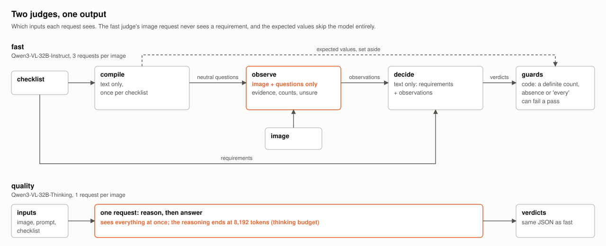

# Design notes

## The problem with single-call judges

The common way to grade a text-to-image output with a VLM is one request: the prompt, a checklist of
requirements, the image, "is each requirement satisfied?". With Qwen3-VL-32B this setup is much more lenient
than a frontier API judge on the same images and checklists (docs/results.md), and rewriting the
system prompt with explicit rules for counts, negation and "every" (`single_v2`) barely moves it.

Reading the failures, the model tends to find what the requirement asks for: a count is confirmed when the
image has one object fewer, a small chimney is overlooked for "no chimney", a colored pot is taken as colored
leaves. Stricter wording does not help much because the request still tells the model what it is supposed to
see.

## Neutral grounding

The neutral judge splits one decision into three requests so that the request that looks at the image never
sees the desired answer.



```
checklist ──► compile (text) ──► plans: kind, subject, neutral question, expected value
                                     │                                  │
image ─────────────► observe (image + questions) ──► observations       │
                                                          │             │
checklist ──────────────────────► decide (text) ──► verdicts ──► guards (code) ──► final verdicts
```

**Compile** turns each requirement into a plan. `count`, `absence` and `universal` plans carry the expected
value and a comparator; the question itself must not contain the target. "There are exactly three cups" becomes
`{kind: count, subject: "cups on the table", question: "Describe their arrangement.", comparator: eq,
expected: 3}`. A validator rejects plans whose question or subject contains the number (digit or word) or an
absence word, and the model is asked to fix them with the error message. Plans depend only on the checklist, so
all images of the same prompt share one compile request.

**Observe** sees the image and the neutral questions only, no prompt and no requirements. It returns evidence,
counts (`count`, or `total` and `matching` for per-instance questions) and an `uncertain` flag.

**Decide** compares the requirements with the observations, text only.

**Guards** are plain code applied after decide. A definite observation that contradicts what the requirement
itself states fails it: a count the requirement gives ("exactly three", "a pair"), a presence check (at least one),
an absence, or "every X" when the requirement says all / every / each / both. A guard can turn a pass into a fail,
never the reverse, and the decide verdicts before the guards are kept in every result, which is how the guard
ablation is computed without extra requests. The first version (`neutral_v1`) also checked counts and "every X"
that the compile step inferred from plurals without a number, and failed every observation flagged uncertain; on
new prompt styles most of those vetoes were wrong (round 2 of the evaluation).

**Presence fix.** The compile step sometimes plans a presence requirement ("Flames are visible in the image.")
as an absence check (count of flames == 0), so the absence guard fails exactly the images that show the object.
So an absence plan whose requirement has no word for something missing, forbidden or excluded ("no",
"without", "only", "empty", "-less", ...) becomes a plain observation that the decide step judges. This removes
the wrong guard on that one requirement; every other guard stays. The plan is repaired in code rather than
retried, because a retry recompiles the whole checklist and moves the other plans too. Every neutral judge in
the results tables has this repair, the first version included; the serving ladder (docs/serving.md) ran before
it.

Cost: per image, one observe and one decide request, plus one compile per distinct checklist. With two images
per prompt that is 2.5 requests per image instead of one; the observe request dominates.

## Where the neutral judge still fails

Tracing 100 development-set statements on which the judge disagreed with both Sol and the audit through plan,
observation and decision: about 60% go wrong at the observe step and the rest at decide; the guards were no
longer a cause. The largest single failure is the observer confirming what a question names or takes for
granted: "Is there a crystal inside the lantern?" gets a faceted crystal that is not there, "describe the patina
of the statue" gets a patina. Then plain misperception (hybrid animals, look-alike objects, garbled text read as
the intended word), and a decide step that is sometimes too strict (a shade of yellow read as "not yellow") and
sometimes too lenient (one part of a compound requirement taken for the whole). Five targeted changes (observer
rules, compile rules against naming the claimed object, an echo of each observation's subject, decide rules, and
a crop-and-describe verification step) each re-decided hundreds of borderline statements with about as many
right as wrong, and none was kept (docs/results.md).

## The quality mode: a thinking model in one call

Qwen3-VL-32B-Thinking writes a reasoning chain before its answer. Asked the single-call question (prompt,
checklist, image), it no longer just finds what the requirement asks for: on held-out images it agrees with Sol
and Gemini about 2 points more than the neutral judge (with the blind audit, a point less), and 7.0 points more
with Sol on prompts that need reasoning (9.3 across all 1,047 reasoning images with labels, docs/results.md).
vLLM's `qwen3` reasoning parser separates the chain from the answer, so the JSON schema constrains only the
answer; the chain needs room (16,384 output tokens, a 20,480-token context). It samples at temperature 0.6 with a
fixed seed per request; greedy decoding loops. Qwen's model card suggests temperature 1.0 with top-p 0.95 and
top-k 20 for this model, which was not tested here.

Sampling does not stop every loop. About 0.6% of prompts that need reasoning send the chain round the same check
until it hits the output limit; the reply has no answer, and the retry starts from scratch. Each request
therefore carries a thinking budget of 8,192 tokens (vLLM's `thinking_token_budget`): at that point the server
ends the reasoning with a short closing line (the profile's `reasoning-config`) and the model answers from what
it has. No main-task chain in our traces came near the budget (the longest reasoning was 5,287 tokens); on reasoning
prompts it cut 0.7% of chains, left statement agreement with Sol unchanged, and took 17% off the batch time.
`--thinking-budget` raises or removes it.

It is more lenient than the neutral judge (+13.5 points of full-image passes against Sol, versus +3.4), so for
RL rewards the fast mode is the safer signal. The obvious combination, the neutral pipeline run on the Thinking
model, was 12-15 statement points behind both: its decide step fails almost every requirement it cannot prove,
and each compile request wrote about 7,500 tokens of reasoning.

## Serving

Both modes run on vLLM 0.32 with Qwen's FP8 checkpoints (block-quantized weights, half the memory of BF16) and an
FP8 KV cache, so far more requests fit at once; the context is cut from the model's 256K default to what a
request needs. Profiles are in `src/fastqwenjudge/profiles`, and docs/serving.md has the measurements behind each
setting.

Requests use JSON-schema constrained output (vLLM structured outputs). When a reply is cut off or fails
validation, the retry tells the model what went wrong (be concise; the exact validation error) instead of
resending the same request, which would usually fail the same way. Each of the neutral judge's requests may write
128 tokens per statement (at least 2,048), in a 16,384-token context: a decide request for 50 statements carries
all 50 observations. With a fixed 2,048 tokens, the compile or observe answer for a checklist of 24-50 statements
was cut off on every attempt and the image got no verdict (6 of the 800 held-out main-task images).

The runner keeps a bounded number of requests in flight. In `pipelined` execution each image runs its own
compile → observe → decide chain; in `staged` execution every compile finishes before any observation starts, and
so on. Results are appended to a JSONL file as they finish, so interrupted runs resume where they stopped.

## Limitations

- Observations can still be wrong. Splitting the request removes the hint, not the model's perception errors,
  and a question that names something can still lead the observer to report it.
- Greedy decoding is not bitwise deterministic under batching: re-judging the same images at another number of
  requests in flight flips about 1% of the fast mode's statement verdicts (1.1% on the held-out main task), and
  about 3% on checklists of more than 16 statements, whose long answers magnify small differences.
- The compile step's validator rejects a neutral question that names the expected count, even when the number
  belongs to something else ("a clock showing one hour" in a plan that counts time cues). On 0.1-0.4% of images
  (1 of the 1,000 held-out images, 4 of each 1,000-image batch in the serving ladder) every attempt fails one of the
  plan checks and the image gets no verdict; the quality mode judges them.
- Yes/no questions as requirements confuse the compile step (it reads "Is there a cat?" as an absence check);
  write requirements as statements.
