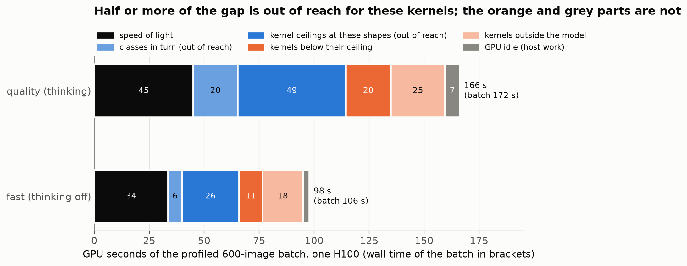

# Roofline and speed of light

How `experiments/qwen38/roofline.py` computes how far a run is from the hardware, how that model was checked, and
how close Qwen3.8-27B's runs get, kernel class by kernel class. Everything is on one H100 80 GB (SXM) with vLLM
0.32.0. Flash-Next has whole-run numbers only ([limits](#limits)).

## Terms

- **Peak.** The H100 SXM datasheet: 1,979 TFLOP/s for dense FP8 matmuls, 989 for BF16, 3.35 TB/s from HBM3. The
  two FLOP figures work out to a 1,830 MHz clock (132 SMs x 8,192 FP8 or 4,096 BF16 FLOPs per clock). The GPU boosts
  to 1,980 MHz when its 700 W budget allows; over the held-out timing run it averaged 1,720 MHz (quality, 668 W) and
  1,686 MHz (fast, 644 W), below the clock the datasheet peaks assume.
- **MFU and MBU.** Model FLOPs (or bytes) per second over the run, divided by peak FLOPs (or bandwidth). They count
  the work the model has to do, not the work the kernels happen to do (padding, recomputation, extra copies).
- **Arithmetic intensity** is FLOPs per byte. The **ridge point** is peak FLOPs over bandwidth: 591 FLOP/byte for
  FP8. A matmul with FP8 weights does 2 FLOPs per weight byte per token, so a step stops being bound by reading the
  weights at about 295 tokens.
- **Roofline time** of some work: the larger of its FLOPs at peak and its bytes at peak bandwidth.
- **Speed of light** of a run: the roofline time of all its work, with every step full (as many requests as the
  server's cap allows: 64 for the 27B, 96 for `flash-quality`, 112 for `flash-fast`). It is a floor that no real
  schedule reaches.
- **GPU busy** is the share of time a kernel is running. It says the GPU had work, not that the work ran fast: a
  kernel moving data at a third of the bandwidth counts as busy all the time it runs.

## The model

The work comes from the architecture and the run's own vLLM counters. P prompt tokens, R requests, S draft rounds
(one per running request per step), D drafted tokens, G generated tokens; k = 3 drafts per round, so the model
verifies V = S x (k + 1) positions while decoding. Mean context c = P / R + G / 2R.

| Work | FLOPs | Bytes |
|---|---|---|
| linear layers (FP8) | 2 x 24.35 G weights x (P + V) | every weight once per engine step: 26.1 GB (the FP8 layers 22.7 GiB, the output layer 1.18 GiB in FP8, the draft head 0.44 GiB) |
| output layer | 2 x 248,320 x 5,120 x (V + D + R) | (in the weights) |
| attention: 16 layers, and the draft head's own layer once per drafted token | 4 x 24 heads x 256 x (16 x (V x c + P x c / 2) + D x c) | the FP8 KV cache: 32 KiB per context token (16 layers x K and V x 4 heads x 256) x c x S, plus the draft head's 2 KiB per token x c x D |
| DeltaNet recurrence | 6 x 48 layers x 48 heads x 128 x 128 x (P + V) | the 16-bit state, 72 MiB per request: read once and written k + 1 times a round (vLLM keeps one state per draft position so any number of accepted drafts can be rolled forward) |
| draft head | 2 x 0.42 G x (D + P) | (in the weights) |
| vision tower (BF16) | 2 x 0.46 G x 4,096 patches x R, and its full attention: 4 x 27 layers x 1,152 x 4,096^2 x R | its 0.86 GiB of weights once per image |

Engine steps are the draft rounds over the mean number of requests running (vLLM's iteration counter counts what the
API server receives, which can merge several engine steps). For the speed of light the steps are the generated
tokens over the measured tokens per round over 64: every step full, with the run's own draft acceptance. FLOPs run at
the FP8 peak (the vision tower's at BF16), bytes at 3.35 TB/s, and the larger of the two is the floor.

Left out of the model: activations, norms, the quantization of activations for the FP8 matmuls, sampling, KV writes.
They appear below as kernels the model does not count.

| 27B, held-out timing run (1,000 images) | measured | speed of light | | MFU | MBU |
|---|---:|---:|---:|---:|---:|
| `quality` | 295 s | 80 s (80 s of FLOPs, 76 s of bytes) | 3.7x | 26% | 26% |
| `fast` | 177 s | 57 s (57 s of FLOPs, 23 s of bytes) | 3.1x | 31% | 13% |

The quality run sits on the ridge: its FLOPs and its bytes would take about as long at peak. 58% of its matmul FLOPs
are prompts (prefill), the rest decoding; the fast run's are 82% prompts. It took 4,862 engine steps against 4,554 had
every step been full: the batch's tail costs about 7% of the steps.

## Check 1: one request

At one request a decoding step is a pass over the weights: the model's 25.6 GB and three draft passes over the draft
head and the output layer (5.2 GB), 30.9 GB in all, 9.2 ms at 3.35 TB/s. In a profile of the 27B at one request,
the FP8 matmuls take 11.6 ms a step: 2.66 TB/s, 79% of peak
bandwidth, every byte the model counts.

| FP8 matmul, one request | weights | in the server | alone, 1-16 rows, with its activation quantization | bandwidth in the server |
|---|---:|---:|---:|---:|
| MLP gate + up (34,816 x 5,120) | 178 MB | 65.4 us | 66.7-69.0 us | 2.73 TB/s, 81% |
| MLP down (5,120 x 17,408) | 89 MB | 33.8 us | 37.0-37.6 us | 2.64 TB/s, 79% |
| DeltaNet input (16,384 x 5,120) | 84 MB | 29.2 us | 32.8-33.5 us | 2.87 TB/s, 86% |
| attention QKV + gate (14,336 x 5,120) | 73 MB | 26.1 us | 29.5-30.1 us | 2.81 TB/s, 84% |
| output projections (5,120 x 6,144) | 31 MB | 14.5 us | 17.0-17.6 us | 2.17 TB/s, 65% |
| output layer (248,320 x 5,120), 4 a step | 1.27 GB | 406 us | 408-415 us (4-16 rows) | 3.13 TB/s, 93% |

The model's byte count holds, and the matmuls read the weights close to what the GPU can stream: a read-only kernel
reaches 3.23 TB/s (96%). The rest of a one-request step is about 4 ms of other kernels (DeltaNet, sampling, attention,
activation quantization, norms), each small, and host gaps (the GPU is busy 82% of the time under the profiler; the
step takes 14.8 ms without it). Closing that last gap is what single-request megakernels do; a judge runs batches.

## Check 2: what each kernel class reaches on its own

`experiments/qwen38/ceilings.py` runs the kernels vLLM runs, at the 27B's shapes, in CUDA graphs, on random data,
with weights and caches rotated so none is served from the 50 MB L2 cache. It is what the hardware and today's
kernels reach at these shapes, the ceiling a run can be held to (each measurement records the SM clock: 1,365-1,980
MHz).

**Memory.** A read-only kernel streams 3.23 TB/s, 96% of the datasheet; a device copy 2.45 TB/s each way.

**FP8 matmuls** (FlashInfer's kernel below 32 rows, DeepGEMM from 32, as vLLM picks), as a share of each one's
roofline time:

| rows (tokens in the step) | MLP gate + up | MLP down | DeltaNet input | attention QKV | output projections | output layer |
|---:|---:|---:|---:|---:|---:|---:|
| 4 | 78% | 72% | 76% | 74% | 55% | 93% |
| 64 | 84% | 75% | 82% | 78% | 66% | 91% |
| 256 | 70% | 60% | 70% | 59% | 57% | 75% |
| 512 | 55% | 68% | 64% | 56% | 64% | 62% |
| 2,048 | 69% | 59% | 69% | 69% | 57% |  |
| 8,192 | 63% | 72% | 70% | 69% | 70% |  |

Below about 128 rows they are bound by reading the weights and reach 54-93% of the bandwidth. A decoding
step at the cap is 64 requests x 4 positions = 256 rows, right at the ridge, where both limits bind: the decoder's
matmuls together run at 1,007 TFLOP/s there, 51% of the FP8 peak. On prompt chunks of 1,024 rows
and more they reach 57-72% (the GPU drops below its 1,980 MHz boost under that load; the same
benchmark on a second node ran these 7% faster, at up to 1,471 TFLOP/s). The numbers here and below come from one
run of the benchmark.

**Attention.** FlashAttention 3 over the FP8 KV cache, as vLLM lays it out (24 query heads on 4 KV heads of 256),
reaches 23-44% of the bandwidth over every shape tried (16-64 requests, 1 or 4 query tokens, 1k-8k context, pages
of 832 tokens as the server uses or 64, the split count capped as under CUDA graphs or left to FA3), about 40% at
64 requests x 2k context. FlashInfer's paged kernels do worse: with 16-bit queries over the FP8 cache at head size
256 they do not build, and with FP8 queries its FA3 path reaches 11-12%. The ceiling is low for this head layout.

**DeltaNet.** vLLM's fused speculative-decoding kernel at 64 requests x 4 positions moves 2.66 TB/s, 79% of the
bandwidth (82% of what a plain read reaches). 78% of its bytes are state writes, one per position; the three
beyond the one a step needs (the per-draft state copies) are about 60%.

**Sampling.** vLLM's top-k / top-p mask (a Triton kernel, top_k 20 and top_p 0.95 as the quality modes use) takes
0.32-0.83 ms for 64-256 rows of ordinary logits, but 2.5-5.2 ms when the answer's JSON grammar has set most of each
row to -inf (20 tokens allowed), and 2.2-3.1 ms when half the rows are masked, as in a step where some requests
reason and others answer (each time including a copy of the logits, 0.04-0.17 ms). Over the whole quality batch its
calls average 2.7 ms: the grammar sends the kernel's threshold search down its slow path. A mask whose cost does not
depend on the values (`kernels/topk_topp.py`, below) takes 0.22-0.56 ms for the same rows and copy, whatever the
logits.


## Where a whole batch goes

A GPU profile of a few seconds can mislead: under a real batch the load swings as requests finish and start. The 600
development images were therefore judged through the installed command with the server under Nsight Systems, every
kernel of the batch recorded and CUDA graphs traced node by node (the server ran with vLLM's `profiler-config:
{"profiler": "cuda"}`, under `nsys profile --capture-range=cudaProfilerApi`, and each batch was bracketed with a POST
to `/start_profile` and one to `/stop_profile`; `experiments/qwen38/nsys_summary.py` sums the kernels). The batches
took 172 s and 106 s, as long as without the profiler. `roofline.py --stats --kernels --ceilings` then sets each
kernel class against its work at the datasheet roofline and at the ceilings above, at the batch's own shapes: decoding
steps of 4 x the requests running through every layer, three draft passes of the requests running through the draft
head and the output layer, prompts in chunks of 8,192 tokens. The tables are the package's settings; a first capture,
with vLLM's own top-k / top-p mask, differs in the sampling row (below).

```bash
# a copy of src/fastqwenjudge/profiles/27b.yaml with   profiler-config: {"profiler": "cuda"}   added under args
nsys profile --trace=cuda --cuda-graph-trace=node --capture-range=cudaProfilerApi --capture-range-end=repeat \
    -o batch fastqwenjudge serve --server 27b_profiled.yaml --port 8000 &
curl -X POST http://127.0.0.1:8000/start_profile
fastqwenjudge judge --mode quality --base-url http://127.0.0.1:8000/v1 --data items.jsonl --out quality.jsonl
curl -X POST http://127.0.0.1:8000/stop_profile
nsys export --type sqlite -o batch.sqlite batch.1.nsys-rep      # after stopping the server
python experiments/qwen38/nsys_summary.py batch.sqlite --out quality_summary.json
python experiments/qwen38/ceilings.py --out ceilings.json
python experiments/qwen38/roofline.py --model Qwen/Qwen3.8-27B-FP8 --stats quality.jsonl.stats.json \
    --kernels quality_summary.json --ceilings ceilings.json
```

| 27B `quality`, 600 images (GPU seconds) | measured | at the datasheet roofline | at the measured kernel ceilings |
|---|---:|---:|---:|
| FP8 matmuls | 81.2 | 40.9 | 72.8 |
| DeltaNet (the speculative-decoding kernel 18.1 s; prompts and mixed steps 11.2 s) | 29.2 | 17.3 | 22.0 |
| attention, language model | 14.0 | 3.5 | 9.2 |
| vision tower (BF16 matmuls 5.1 s, attention 3.3 s) | 8.4 | 3.6 | (not measured) |
| sampling (the top-k / top-p mask 1.1 s; resampling for the drafts and bookkeeping 0.9 s) | 2.0 | | 2.0 |
| kernels the model does not count: activation quantization 7.6, copies 5.9, norms 5.5, activation 3.8, the rest 1.8 | 24.6 | | |
| GPU idle | 6.7 | | |
| **total** | **166** | speed of light: **45** | |

The fast batch (thinking off, 106 s): FP8 matmuls 51.2 s (roofline 29.7, ceiling 47.9), DeltaNet 12.5 (5.6, 7.1),
attention 4.5 (1.0, 2.6), vision 7.5 (3.6), sampling 0.8 (greedy), uncounted kernels 18.5, idle 2.8; speed of light
34 s.

Read as a staircase from the speed of light to the measured time:



| | `quality` | `fast` | what it is |
|---|---:|---:|---|
| speed of light | 45 s | 34 s | all FLOPs and all bytes of the batch at peak, overlapped |
| + classes one after another | 65 s | 40 s | a layer's matmuls (compute-bound) and its DeltaNet or attention (memory-bound) run in turn, not overlapped |
| + today's kernels at these shapes | 114 s | 66 s | matmuls at the ridge (51% of peak at 256 rows), FlashAttention 3 at 40% of the bandwidth for this head layout, DeltaNet's state copies |
| + kernels below their ceiling | 135 s | 77 s | matmuls at 90% of their ceiling, attention at 66%, DeltaNet at 75%; sampling at its ceiling |
| + kernels the model does not count | 160 s | 95 s | activation quantization, norms, copies, activations: small memory-bound kernels: 850,884 quantizations in the batch, about 290 a step |
| + GPU idle | 166 s | 98 s | host work between steps |

So the gap between the profiled GPU time and the speed of light, 3.7x (quality: 166 s against 45) and 2.9x (fast: 98
against 34), splits three ways. (The batches took 172 s and 106 s of wall time; the rest is before the first kernel
and after the last, outside the capture.) For the quality batch, more than half of the gap (57%) is not reachable with
these kernels at these batch shapes: running layers in turn, matmuls at the ridge point, the attention kernel's
ceiling for 4 KV heads of 256, and the state copies speculative decoding needs. More requests per step would move the
matmuls past the ridge, but each image would take longer and the cache fills past 90
([serving.md](serving.md#how-many-requests-at-once)). About a sixth (17%) is kernels below what they reach alone, and
a quarter (26%) is kernels outside the model's work and the GPU waiting (for the fast batch, whose steps carry long
prompts, a third). The vision tower's kernels were not measured alone, so its 5 s above its roofline are counted in
the first share; without it, that share is 53%. Those last two are where fixes can come from.

## What was fixed, and what was not

- **Sampling: fixed on the 27B.** `kernels/topk_topp.py`, a vLLM plugin on in the 27B profile, finds the same top-k /
  top-p thresholds in three passes over the logits whose cost does not depend on the values. In the first capture,
  with vLLM's kernel, sampling took 8.7 s of the quality batch (the mask 7.8 s: 2,915 calls at 2.7 ms); with the
  plugin it takes 2.0 s (the mask 1.1 s: 0.38 ms a step), at its ceiling. The quality judge runs 7% more images per
  second in steady state (two pairs, alternating; [serving.md](serving.md#the-ladder)). Batch times did not change
  measurably: the ~7 s saved is less than the 14 s by which two batches of the same settings differed, and the
  capture with the plugin, on another node, had the matmuls 2% slower and the GPU idle 3 s longer, so its batch took
  the same 172 s. Verdicts moved no more than a rerun moves them. On Flash-Next, whose steps are longer, there was no
  gain beyond the run-to-run noise, and its profile keeps vLLM's mask.
- **Small kernels: not fixed.** vLLM can fuse an RMSNorm, or SiLU-and-multiply, into the FP8 quantization of the next
  matmul's input. On the 27B the passes find nothing to fuse: its matmuls go through one op that quantizes inside
  (FlashInfer's kernel below 32 rows, DeepGEMM above). With that op switched off
  (`VLLM_BLOCKSCALE_FP8_GEMM_FLASHINFER=0`) the quantization is in the graph and the activation fusion matches (the
  norm fusion still does not), but the DeepGEMM-only path is 3% slower on the fast judge and the fusion does not win
  it back.
- **The host: a regression caught.** A length bound on each evidence string in the answer schema (`maxLength`) made
  the grammar's token masks, which the server builds on the CPU for every request at every step, ten times slower
  (224 against 21 µs a token). The GPU then sat 67% busy on the fast batch (143-148 s instead of 105) and 87% on the
  quality batch. The bound was removed. GPU busy does not say how well the GPU works; GPU idle does say how long it
  waited.


## Limits

- Flash-Next: whole-run speed of light only (56 s for `flash-quality`, bound by the bytes of the experts each step's
  tokens route to, and 15 s for `flash-fast`, where FLOPs and bytes take about as long). Its per-class numbers are not
  reported: its tensor-parallel all-reduce and the 4-bit expert kernel need their own ceilings, which were not
  measured. - The work model counts what the model must do. Kernels that do more (vLLM's state copies are counted as
  model work, since vLLM's design needs them; the FP8 matmuls' padding to 128-row tiles is not) show up as lower
  efficiency. - Ceilings are measured on random data at fixed shapes. Real batches mix shapes from step to step, so
  the achievable time of a run is estimated from the shapes it sees, not measured.