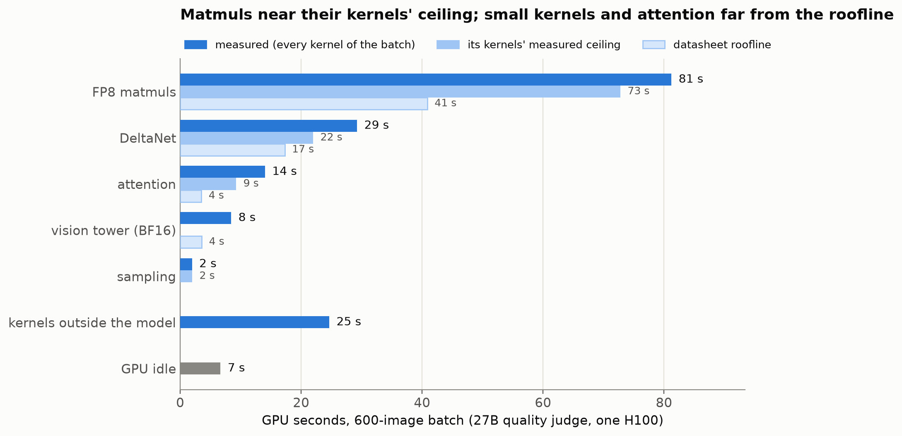
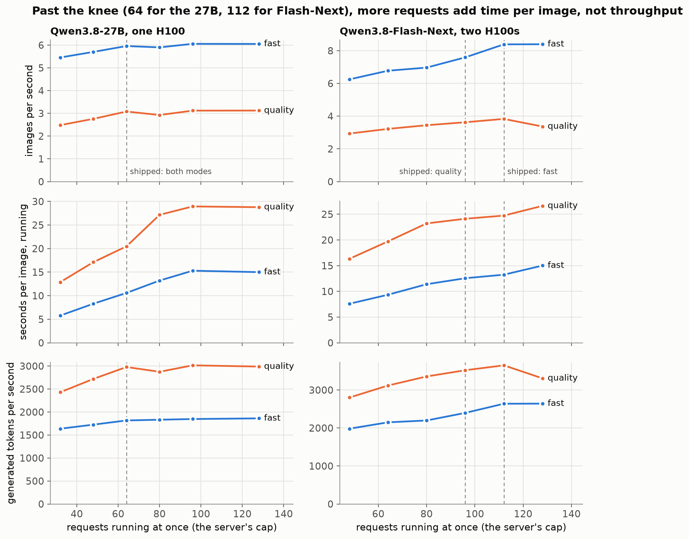
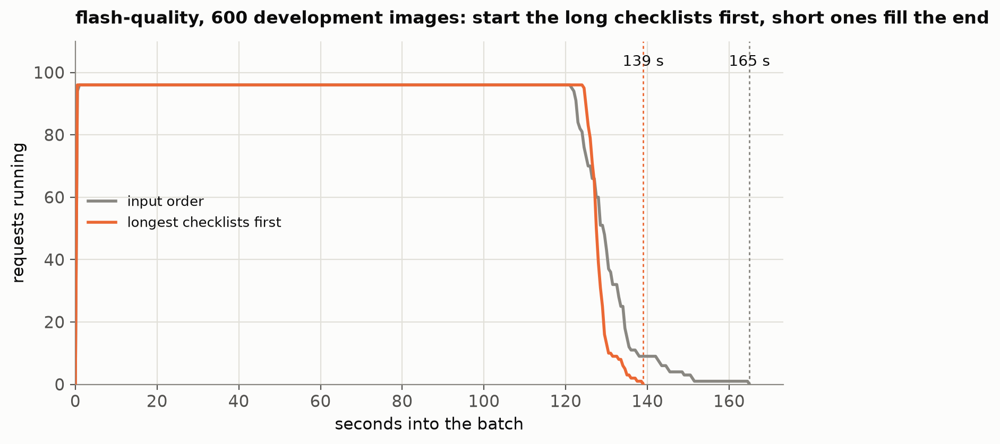

# Serving: how fast, and why

Everything here runs on H100 80 GB (SXM) GPUs with vLLM 0.32.0. A **batch time** is the time to judge every image of a
set submitted at once; **steady state** keeps a fixed number of images in flight for a few minutes and counts images
per second; **time per image** is the time a request spends running on the server (prefill + decode), without
queueing. Development numbers are on 600 main-task images (or the 847 that need reasoning); held-out numbers on the
1,000 of [results.md](results.md). Settings were compared inside one job, against an anchor run at the start and
repeated at the end: the same settings measured up to 27% apart on two different nodes (6.4 against 8.1 images/s), and
usually 1-7% apart inside one job (once 26%: 134 s against 106 s).

## The shipped settings

| Setting | 27B (`profiles/27b.yaml`) | Flash-Next (`profiles/flash_next.yaml`) | Why |
|---|---|---|---|
| Checkpoint | Qwen's FP8 (128x128 blocks) | NVIDIA's NVFP4 (experts in 4-bit, the rest 16-bit) | Flash-Next's FP8 checkpoint needed four GPUs |
| GPUs | 1 | 2: tensor parallel, experts split between them | |
| Requests running at once | 64 | 96; 112 for `flash-fast` | measured, below |
| GPU memory for vLLM | 90% (vLLM's default) | 92% | Flash-Next at 95% with 128 requests failed to start |
| DeltaNet state | 16-bit (the checkpoint asks for 32) | 16-bit | the state is copied per draft token; half the bytes |
| Prefix caching | off | off | every request has its own image: little to share, and it costs cache |
| KV cache | FP8 | FP8 (and the sparse-attention indexer's) | |
| Draft tokens | the checkpoint's MTP head, 3 per step | the same | worth ~40% to the 27B's thinking judge |
| Output layer | block FP8 (our vLLM plugin) | 16-bit | 4% on the 27B; no gain on Flash-Next |
| Top-k / top-p mask | three passes (our vLLM plugin) | vLLM's | 7% more images per second for the 27B's quality judge in steady state; no gain on Flash-Next beyond its noise |
| Context | 36,864 tokens | 36,864 | prompt and image (1.5-2k tokens) plus up to 32,768 output |
| Reasoning cut at | 8,192 tokens | 8,192 | below |
| Order of a batch | the longest checklists first | the same | below |

Flash-Next's 51-billion-parameter n-gram embedding table stays in host memory (`engram-config: cpu_offload`), and its
experts run on vLLM's "humming" mixed-precision kernel: H100s have no FP4 tensor cores, so the 4-bit weights are
unpacked inside the matmul.

## Qwen3.8-27B on one H100

### The ladder

| 600 development images, one H100 | `fast` judge | `quality` judge (medium + strict) |
|---|---:|---:|
| vLLM's recipe for the model (FP8 KV cache, 3 draft tokens, 128 requests), prefix caching off | 115 s | 369 s (65 requests evicted and restarted) |
| + 16-bit DeltaNet state, at most 64 requests at once | 100 s | 184 s |
| + the output layer in FP8 | 99 s (anchor 103) | 177 s (anchor 185) |
| + the longest checklists first | 104 s (anchors 110, 106) | 171 s (anchors 182, 178) |
| + the top-k / top-p mask in three passes | (greedy: no mask) | 175, 177 s (anchors 170, 184); steady state 3.23 against 3.03 images/s |

Each later row was measured against its own anchor in the same job, shown in brackets; the earlier rows are from
another node. vLLM's own defaults do not start on this model (1,024 sequences against 824 slots for the recurrent
state); with the sequence cap lowered to 512 so they start, they evicted and restarted 626 requests in one thinking
batch and took 1.8x the time of the 16-bit state with the cap of 64 (560 s against 317 s, at the model's default
reasoning effort).

The 16-bit state and the cap only work together. With 16-bit state alone the server admits more requests than its
cache holds and evicts them; the cap alone just runs fewer. Together: 30% more generated tokens per second (2,809
against 2,165 for the anchor in the same job) on the thinking judge, 10% more prompt tokens per second on the fast
one, and no evictions.

### Where the time goes, and the speed of light



[roofline.md](roofline.md) has the method, the checks on it and the measured kernel ceilings. In short,
`experiments/qwen38/roofline.py` counts a run's work from its own counters (2 FLOPs per weight per token for every
linear layer, attention over the context, the DeltaNet recurrence, the draft head, the vision tower; per engine step
every weight read once, the KV cache, and the DeltaNet state with its per-draft copies) and sets it against the
H100's peaks: 1,979 TFLOP/s for FP8, 3.35 TB/s from memory. The speed of light is all of that work at peak, every
step full. No real schedule reaches it.

| 27B, held-out timing run | batch | speed of light | measured / floor | MFU | MBU |
|---|---:|---:|---:|---:|---:|
| `quality` | 295 s | 80 s (80 s of FLOPs, 76 s of bytes) | 3.7x | 26% | 26% |
| `fast` | 177 s | 57 s (57 s of FLOPs, 23 s of bytes) | 3.1x | 31% | 13% |

The GPU is busy 97% of the time; busy is not fast. Every kernel of a 600-image quality batch, profiled with Nsight
Systems, against the same work at the datasheet roofline and at what the same kernels reach alone at the batch's
shapes (`experiments/qwen38/ceilings.py`):

| Kernel class, 27B `quality`, 600 images | GPU time | at the roofline | at the kernels' measured ceiling |
|---|---:|---:|---:|
| FP8 matmuls | 81 s | 41 s | 73 s |
| DeltaNet recurrence | 29 s | 17 s | 22 s |
| attention (FlashAttention 3, FP8 KV cache) | 14 s | 3.5 s | 9 s |
| sampling (top-k / top-p over 248,320 tokens) | 2 s (9 s with vLLM's mask) | | 2 s |
| vision tower (BF16) | 8 s | 4 s | |
| kernels the model does not count (activation quantization, norms, copies) | 25 s | | |
| GPU idle | 7 s | | |

- **The matmuls** run at 90% of what their kernels (DeepGEMM; FlashInfer's below 32 rows) reach at these shapes. A
  decoding step at the cap is 64 requests x 4 verified tokens = 256 rows, right at the H100's ridge point for FP8
  weights (about 295), where the matmuls reach about half of the FP8 peak; long prompt chunks reach 57-72%.
- **DeltaNet** is memory-bound by design (6 FLOPs per byte), and 78% of its kernel's bytes are state writes: vLLM
  keeps one 1.5 MB state per layer per request per draft position, so that any number of accepted draft tokens can
  be rolled forward. The three writes beyond the one a step needs are about 60% of the bytes. A kernel that writes
  the state once a step was correct but slower (below).
- **Attention** is at 66% of its kernel's ceiling, but the ceiling is low: FlashAttention 3 reaches about 40% of the
  bandwidth for 4 KV heads of 256 with an FP8 cache; FlashInfer's kernels do worse or do not build for this layout.
- **Sampling** was far from its ceiling: once the answer's JSON grammar has set most of the vocabulary to -inf,
  vLLM's top-k / top-p kernel takes 2.7 ms a call instead of 0.3-0.8 (its threshold search depends on the values).
  Our plugin (`kernels/topk_topp.py`) finds the same thresholds in three passes whose cost does not: 0.38 ms a step,
  1.1 s of the batch instead of 7.8. In steady state that is 7% more images per second; a batch's time does not show
  it beyond the run-to-run noise ([roofline.md](roofline.md#what-was-fixed-and-what-was-not)).

For the quality batch more than half the gap to the speed of light (57%; 53% without the vision tower, whose kernels
were not measured alone) is out of reach for these kernels at these batch shapes; about a sixth is kernels below their
ceiling, and a quarter kernels the model does not count and the GPU waiting
([roofline.md](roofline.md#where-a-whole-batch-goes)).

### How many requests at once



Steady state at 192 images in flight, the server's cap swept (ladder part `27b_k`):

| Cap | `fast` images/s | time per image | `quality` images/s | time per image |
|---:|---:|---:|---:|---:|
| 32 | 5.46 | 6 s | 2.48 | 13 s |
| 48 | 5.70 | 8 s | 2.76 | 17 s |
| **64** | **5.94-5.97** | **11 s** | **3.05-3.12** | **20-21 s** |
| 80 | 5.90 | 13 s | 2.93 | 27 s |
| 96 | 6.06 | 15 s | 3.12 | 29 s |
| 128 | 6.05 | 15 s | 3.12 | 29 s |

Past 64 the 27B gains at most 2% while each image takes about 1.4x as long, and above about 90 the cache is full
(26-56 requests evicted; at 95% of GPU memory, 96 ran with 15 evictions on the quality judge). 64 is the knee.

### Draft tokens

The checkpoint's own MTP head proposes 3 tokens per step; the server verifies them in the same forward pass. It is
worth about 40% to the 27B's thinking judge at its default effort (2,250 against 1,600 generated tokens per second
without drafts) and accepts
about 3.1 tokens per step of a possible 4. Longer drafters (DFlash2 and DSpark with 7 draft tokens) keep about 0.9
more tokens per step, but at 54 requests in flight the step is compute-bound and checking 8 positions instead of 4
costs more than it saves: 22-25% slower.

## Qwen3.8-Flash-Next on two H100s

| 600 development images | `flash-fast` judge | `flash-quality` judge |
|---|---:|---:|
| development settings (85% memory, 128 sequences, prefix caching on) | 102 s | 202 s |
| prefix caching off | 99 s | 196 s |
| + 16-bit DeltaNet state, at most 64 | 99 s | 170 s |
| + 92% of GPU memory, at most 96 | 80-81 s (anchor 91) | 150-154 s (anchor 195) |
| + the longest checklists first | 75 s (anchors 81, 79) | 139 s (anchors 165, 156) |
| + 112 requests for `flash-fast` | 73-75 s (anchor 78) | (144-149 s against 142 s: kept at 96) |

The held-out run of 2026-10-30 used the third row's settings (288 s and 154 s for 1,000 images); the timing run of the
release, with the last row's, took 249 s and 121 s. Their speeds of light, at their caps of 96 and 112 requests, are
56 s for `flash-quality`, bound by memory (the experts each step's tokens route to), and 15 s for `flash-fast`, where
FLOPs and bytes take about as long: 4.5x and 8.0x. A profile of `flash-quality` at 64 in flight: the 4-bit expert
matmuls 26% of GPU time, the 16-bit dense matmuls 19%, all-reduce between the two GPUs 15%, the hyper-connection
stream mixing 8%, attention 7%, DeltaNet 6%, sampling 5%, routing 3%; the GPUs idle 5% of the time (16% for
`flash-fast`), mostly host work inside the forward pass, in the parts Flash-Next runs outside CUDA graphs (its graphs
break around its custom layers).

Steady state, tensor parallel at 92% (ladder part `flash_g`): 6.25 / 2.94 images/s (fast / quality) at a cap of 48,
6.78 / 3.22 at 64, 7.49-7.69 / 3.58-3.67 at 96, 8.39 / 3.83 at 112 and 8.39 / 3.37 at 128, with the time per image
almost flat from 96 to 112. In batches, where the quality judge's time is set by its last long chains, 112 helped
only `flash-fast` (73-75 s against 78 s; quality 144-149 s against 142 s), so the two modes start their servers
with different caps.

## The batch's tail



A batch ends with a few long requests on an emptying GPU. From per-request logs, the share of a 600-image batch with
fewer requests running than the cap: 4-5% (27B fast), 13-14% (27B quality), 7% (`flash-fast`) and 23-26%
(`flash-quality`); judged as five batches of 120, 28-64%, and the batches took 17-41% longer than one batch of 600.

**The longest checklists first.** The client starts images in order of checklist length (statements, then
characters) and admits requests of images already started before new ones. It cuts the 600-image batches by 4-5%
(27B) and 6-13% (Flash-Next), and the time with the GPU not full to 1% (fast) and 6-10% (quality), with verdicts
changing no more than between two identical runs (2.3% / 4.2% of statements on the 27B against 2.2% / 4.2% between
reruns). It is the default (`--objective makespan`); `--objective latency` keeps input order.

**Caps on reasoning and on the answer.** Of 19,023 reasoning chains in the development runs, the longest ran 8,382
tokens with its answer and none came near the 32,768-token limit. But one is enough: in a 27B run on the 847 reasoning
images through the CLI, a single request ran for the last ~160 s of a 467 s batch, alone on the GPU at 70-250 tokens
per second. The quality modes send vLLM's `thinking_token_budget` of 8,192 tokens; when it runs out, the server ends
the reasoning with the profiles' closing line ("Considering the limited time, I have to give the final answer based on
my thinking so far.") and the model answers. With a 64-token budget in a test, every one of 16 answers still parsed.

The budget did not stop the next one: in a 600-image run with it, one request again ran alone for ~150 s (about
33,000 tokens at 190-250 tokens per second), so the loop was in the answer, after the reasoning. Ladder part `27b_n`
ran the quality judge twice on the 600 regular and the 847 reasoning images with log-probabilities requested, without
them, and with the budget: 8,719 chains, none looped (the longest 8,426 tokens), and the budget cost nothing
measurable (174-175 and 309-348 s against 173-175 and 318-335 s). Loops are rare, 2 in about 30,000 chains here,
which is still about one 1,000-image batch in 15. So the answer is bounded too: the whole output at most the
reasoning budget plus 2,048 tokens and 200 per statement (12,240 tokens for a 10-statement checklist, instead of
32,768), and an answer cut there is asked again with a note to keep each evidence to one short sentence. Of 207,461
answers on record, the closest came to a third of its bound. A cap on each evidence string in the schema (JSON
Schema's `maxLength`) would have stopped a looping string sooner, but with any such bound xgrammar 0.2.8 builds each
token's mask about ten times slower (224 against 21 µs on the CPU), and the GPU waited on it: 67% busy on the fast
judge and 143-148 s for the 600 images instead of about 105.

**More draft tokens as the batch empties** would use the idle GPU, and vLLM can switch the draft length by the
number of requests running. On the 27B, 5 draft tokens at 16 or fewer running accepted 4.2 tokens per step against
3.4, but vLLM keeps the state copies for the longest draft for every request all batch long: 37 requests ran instead
of 55, and the thinking batch took 279 s against 182 s. With 7 the server failed. On Flash-Next both failed to
start (with 5: "QSA ring capacity 12 must divide the attention block size 1696", a constraint of its sparse
attention).

## Tokens per second and latency per request

How each figure is counted:

- **Whole batch** (the tables in README.md and results.md): the server's token counters over a batch of the 1,000
  held-out images, divided by the batch's time from the first request sent to the last answer back. Server start-up
  is not in it (about 2 minutes for the 27B and 4 for Flash-Next, before the clock starts); prefill and the batch's
  tail are. Generated tokens include thinking tokens, prompt tokens include the image's (about 1,000), and per GPU
  divides Flash-Next's total by its two GPUs.
- **Steady state** (`figures/requests_in_flight.png` and the request-cap sweeps): the same counters over 180-240 s
  with 192 images in flight, after 90-120 s of warm-up, so neither the start nor the tail is in it.
- **Per request** (vLLM's own per-request metrics, in its benchmark's terms): time to first token, from the request's
  arrival, so it includes time in the queue; time per output token, a request's decode time over its output tokens
  (prefill excluded), whose inverse is the request's decode speed; and inter-token latency, the time between a
  request's successive outputs (with three draft tokens a step can give it up to four tokens). Under a full batch
  these were measured once per mode on the 600 development images, with the shipped settings and finer histogram
  buckets than vLLM's defaults so the percentiles resolve; one image at a time, from the 30 images of the timing run.

| Under a full batch, 600 development images | batch | decode speed per request: 1 / mean, median, slowest 5% (tokens/s) | time per output token: mean, median, p95 (ms) | time to first token: mean, p95 (s) | of which queued (mean, s) | prefill: median, p95 (s) | inter-token latency, median (ms) |
|---|---:|---:|---:|---:|---:|---:|---:|
| `fast` | 105 s | 29, 29, 21 | 35.0, 34.5, 48.1 | 27.3, 38.5 | 24.6 | 0.39, 1.15 | 89 |
| `quality` | 173 s | 46, 45, 36 | 21.8, 22.2, 27.6 | 16.8, 30.7 | 15.4 | 0.23, 1.15 | 36 |
| `flash-fast` | 78 s | 25, 26, 18 | 39.4, 38.9, 54.3 | 15.7, 28.0 | 12.9 | 0.25, 0.51 | 144 |
| `flash-quality` | 146 s | 39, 38, 30 | 25.9, 26.0, 32.8 | 7.5, 14.7 | 6.6 | 0.15, 0.48 | 42 |

Under a full batch each request decodes at 25-46 tokens per second, because 64-112 requests share every step; the
whole-batch tables show what the server does in total. Time to first token there is mostly queueing: the client
keeps more requests in flight than the server runs, so a waiting request starts the moment a slot frees. The fast
modes decode more slowly per request than the quality modes because their steps carry more prompt prefill (their
answers are short, so prompts are a larger share of each step: 82% of the fast batch's matmul FLOPs are prompts,
[roofline.md](roofline.md#the-model)).

One image at a time (30 development images, the timing run): time to first token 0.27-0.28 s for all four modes, and
decode speeds of 228 (`fast`), 198 (`quality`), 308 (`flash-fast`) and 240 (`flash-quality`) tokens per second, with
the draft head adding up to three tokens a step; an answer takes 1.3-4.0 s.

## What was tried and not kept

| | Result |
|---|---|
| **27B** | |
| Prefill chunks of 16k or 4k tokens | 177-178 s against 179-192 s for the anchors: within noise |
| Requests without a per-request seed; FlashInfer's sampler | no reliable gain (vLLM's model runner V2 uses its own sampler either way) |
| FlashInfer attention; FlashAttention with up to 128 KV splits | 111 / 181 s and 108 / 177 s against the anchors' 109-110 / 179-187 s |
| 4-bit weights (RedHat INT4, Machete kernel) | 10-20% slower: unpacked to 16-bit inside the matmul, half the FP8 tensor-core rate |
| DFlash2 (3 or 7 draft tokens) and DSpark (7) drafters | DFlash2 with 3: 103 / 195 s against the built-in head's 103 / 189 s; with 7, DFlash2 and DSpark 22-25% slower on the quality judge (231-237 s) |
| 5 or 7 draft tokens as the batch empties | slower or failed (above) |
| A Triton kernel that writes the DeltaNet state once a step and keeps the accepted window's inputs in a ring, replaying them next step (like vLLM's ReplaySSM for Mamba2) | correct with vLLM's per-draft state blocks kept (verdicts within rerun noise), but 3-6% slower (111-112 / 180-184 s against 105-108 / 173-176 s); with one state block per request, to also free the memory, it gave wrong tokens under load and the cause was not found. Not in the package |
| Top-k / top-p mask from the 64 largest logits | same tokens kept; 164-175 s against 174-175 s (the three-pass mask replaced it) |
| vLLM's fusions of RMSNorm and SiLU-and-multiply into the next matmul's FP8 quantization | nothing to fuse while the matmul quantizes inside its own op; on vLLM's DeepGEMM-only path the activation fusion matches, but that path is 3% slower on the fast judge (5.72 against 5.94 images/s) and the fusion does not win it back (5.71-5.74) |
| A 4,000-character bound on each evidence string (the schema's `maxLength`) | xgrammar's token masks 10x slower; the GPU waited on them: 143-148 s against about 105 s on the fast judge |
| **Flash-Next** | |
| torch.compile on | 94 / 179 s against 93 / 173-179 s |
| The dense layers in block FP8 | 143 / 188 s alone (its first rung, with new matmul shapes compiling), 105 / 194 s with the FP8 output layer, against 103 / 191 s and 105 / 204 s |
| Two replicas (data parallel, experts shared) instead of one across both GPUs | steady state: +2-11% fast, -4-10% quality; batches 80 / 169 s against 73-78 / 142-149 s |
| 95% of GPU memory, 128 requests | failed to start with 3 draft tokens; with 2, 78 / 153 s: a tie |
| The top-k / top-p mask from the 64 largest logits | 155-156 s against 151-152 s |
| The three-pass top-k / top-p mask | steady state 3.37 and 3.90 against 3.53 and 3.68 images/s: no gain beyond noise |

## Measuring

- A batch is judged with every image submitted at once; times exclude server start-up (about 2 minutes for the 27B,
  4 for Flash-Next).
- Verdict changes are the check that a serving change is only a serving change: identical runs flip 2.1-2.6% of
  greedy statement verdicts and 3.7-5.6% of sampled ones, and the kept changes flipped 2.3-2.8% and 4.2-5.4%. The
  greedy figures are the written verdicts; with the fast modes' cut-offs applied (many probabilities sit near them),
  identical runs flip 2.7-3.3% (Flash-Next, 0.998) and 4.0-5.0% (27B, 0.999), the kept changes 2.9-3.8% and 4.6-5.4%.
- Settings were compared inside one job, with the anchor repeated at the end. The same Flash-Next settings measured
  6.4 and 8.1 images/s on two nodes (the GPUs equally clocked, but busy 77% against 89% of the time: host work)
  and 8.14 and 8.22 inside one job.
- `experiments/qwen38/ladder.py` runs settings one after another on the same images (`ladders/` has every one, with
  the reason it was run in its header; parts J-J5, M, `flash_c` and `flash_k` used kernels that are not in the
  package, and G, Q, Q2, `flash_l` and `flash_l2` are void, their headers say why); `profile_gpu.py` profiles a server
  under load and sums GPU time by kernel class; `roofline.py` turns a run's counters into MFU, MBU and the speed of
  light, and with a whole-batch kernel summary (`nsys_summary.py`) and the kernel ceilings (`ceilings.py`), the split
  of a batch's time described in [roofline.md](roofline.md).

```bash
python experiments/qwen38/ladder.py --ladder experiments/qwen38/ladders/27b_k.yaml --model <checkpoint> \
    --items <items folder> --out <results>/27b_k
python experiments/qwen38/roofline.py --model Qwen/Qwen3.8-27B-FP8 --run <results>/final_27b/heldout \
    --judge think_medium_strict
python experiments/qwen38/ceilings.py --out <results>/ceilings.json
python experiments/qwen38/nsys_summary.py <capture>.sqlite --out <results>/quality_summary.json
python experiments/qwen38/roofline.py --model Qwen/Qwen3.8-27B-FP8 --stats <out>/dev600_quality.jsonl.stats.json \
    --kernels <results>/quality_summary.json --ceilings <results>/ceilings.json
```
