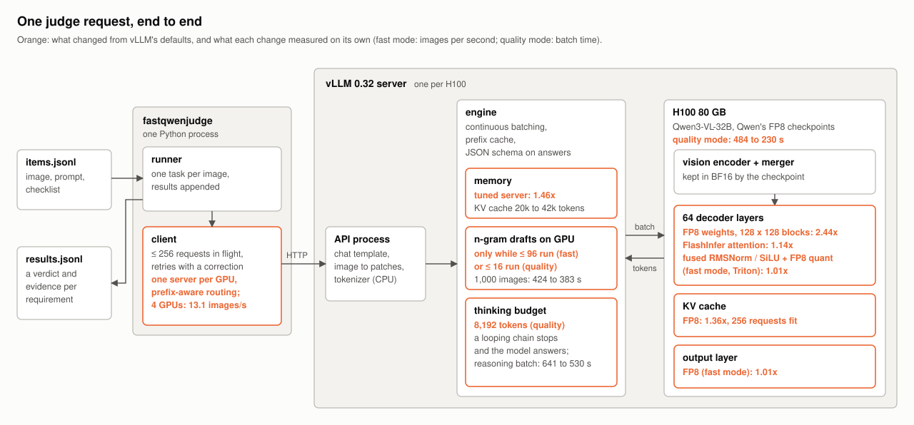
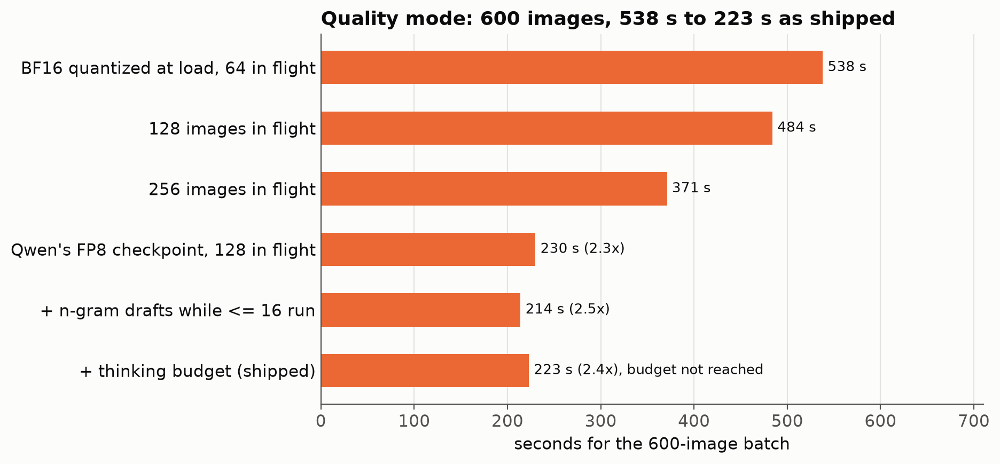
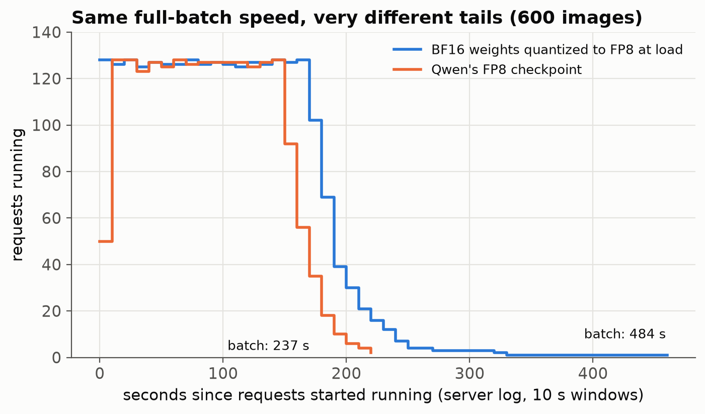
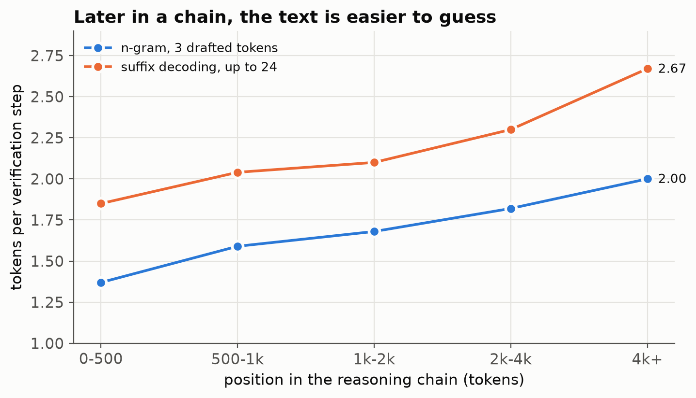
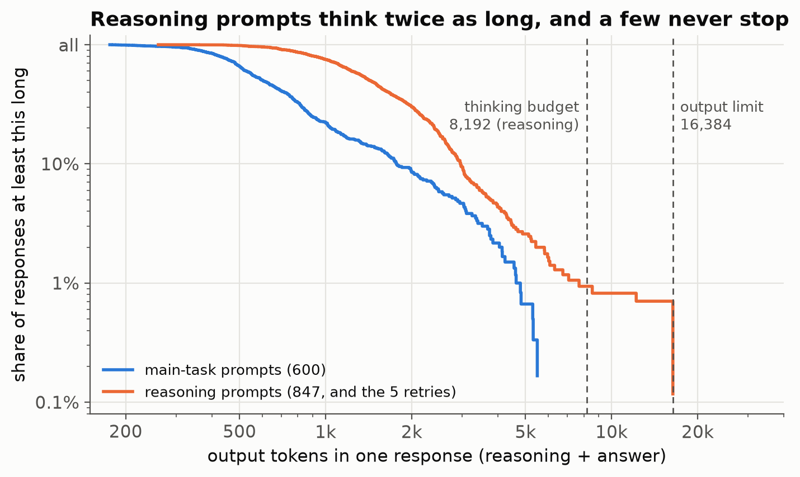
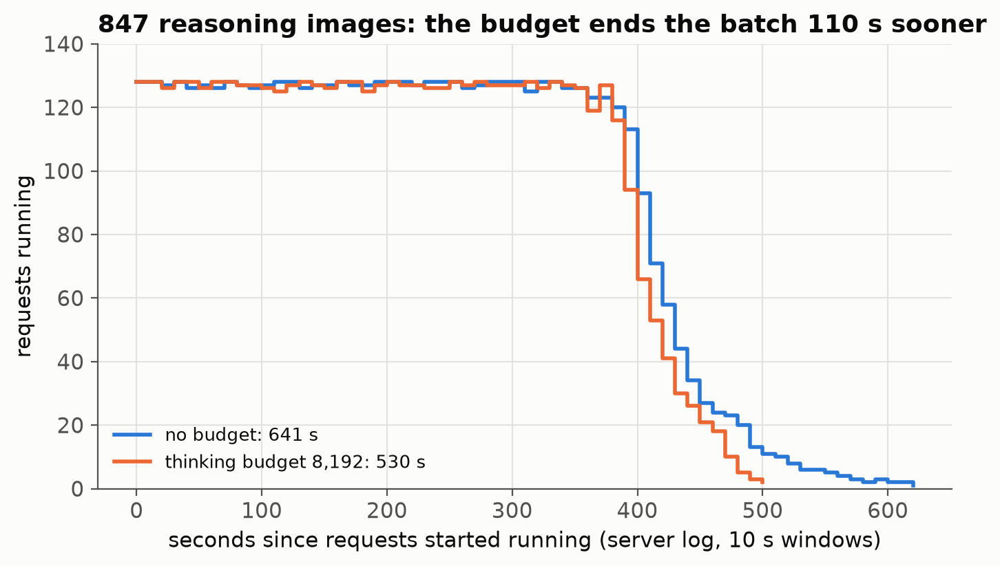

# Serving: how fast, and why

Everything here runs on one H100 80 GB (SXM) unless it says otherwise, on vLLM 0.32. Throughput is images per
second at a fixed number of requests in flight; a batch's time is measured to its last verdict, which is what a
pipeline waiting on the judge actually waits for. Price assumes $3 per H100-hour. Every serving change that can
move verdicts (weights, KV cache, kernels) was re-checked for agreement with GPT-6 Sol and the blind audit,
because changing numerics changes verdicts.

## Fast mode

### Where the time goes

PyTorch profiles taken inside the server under the real judge load
(`experiments/kernels/profile_server.py`), share of GPU kernel time with FlashInfer and n-gram drafts (the
ladder's step before the fused kernels):

| Images in flight | GPU busy | FP8 matmuls | Attention | BF16 matmuls (vision, output layer) | Small elementwise kernels |
|---:|---:|---:|---:|---:|---:|
| 1 | 92% | 74% | 14% | 3% | 8% |
| 64 | 95% | 55% | 25% | 3% | 17% |
| 256 | 96% | 52% | 30% | 3% | 15% |

Per image at full load the judge computes about 1,740 prompt tokens and generates about 1,090. The matmuls are
about 180 TFLOP per image (90 ms at the FP8 peak) and decode attention reads about 220 GB of FP8 KV cache (66 ms
at 3.35 TB/s). With the small kernels' memory floor and the BF16 vision encoder, the floor is about 192 ms per
image, 5.2 images/s. That setup runs at 322 ms per image, 3.1 images/s, about 60% of that floor: the matmuls
are at about 57% of the FP8 peak, attention at about 78% of its bandwidth bound, and the small elementwise kernels
(RMSNorm, the FP8 activation conversions, SiLU x mul, MRoPE) take 46 ms against a 24 ms floor.

### The ladder

Full table, including energy, MFU and MBU: [ladder.md](ladder.md). Accuracy on the ladder is full-image agreement
(the judge and Sol agree that every requirement holds) on 2,106 GenEval and GenAI-Bench images with Sol labels (all
but two of them in the final evaluation set), with the first version of the neutral judge before the presence fix:
the ladder checks that serving changes leave verdicts alone. The judge changes that raised agreement came after it
([results.md](results.md)). Two steps reuse another step's verdicts instead of judging again: vLLM's defaults use
the tuned BF16 server's (same weights and precision), and n-gram speculation uses FlashInfer's (the drafts only
propose tokens the model then checks).

- **Tuned server, BF16 (1.5x).** vLLM's defaults, with the three flags needed to start and stay up on one H100 (a
  6,144-token context instead of the model's 256K, no video inputs, the multimodal cache off), hold 20,320 tokens of
  KV cache, about 15 running requests. The tuned server gives vLLM 95% of GPU memory instead of 90%, caps images at
  1 megapixel and sizes the scheduler for image requests (64 sequences, 8,192 batched tokens): the KV cache doubles
  to 41,776 tokens, and the KV cache, not compute, decides how many image requests run at once.
- **FP8 weights (3.6x).** Qwen's block-quantized FP8 checkpoint frees about 29 GiB for KV cache and halves the
  bytes each decode step reads. Full-image agreement with Sol 83.0% to 83.5%.
- **FP8 KV cache (4.8x).** Twice the tokens in the same memory, so 256 requests fit.
- **FlashInfer attention (5.5x).** At 256 in flight attention was 40% of GPU time; FlashInfer's FP8 decode kernel
  cut it to 30% (+14% at full load, 6% slower for one image alone).
- **n-gram speculation while at most 96 requests run.** Drafts the next 3 tokens by copying from earlier text,
  which a judge does a lot (JSON keys, restated requirements). Always on, it is +76% at one image in flight and
  -19% at 256, where checking the drafts costs real compute; vLLM's draft-length schedule turns it off above 96
  running. The 1,000-image batch: 424 s to 383 s, with its tail halved.
- **Fused RMSNorm / SiLU + FP8 quantization kernels.** Triton kernels, written for Qwen3-VL's decoder layer shapes,
  that fuse the norm or activation with the FP8 conversion of the next matmul's input. They write the same FP8
  bytes and scales as vLLM's path, except for rare reduction-order differences at large batch. A vLLM plugin
  swaps them in (`FQJ_FUSED_KERNELS=1`). +1% on its own; the output layer in block FP8 adds another +1%.

Final: 3.17 images/s at full load, 5.6x vLLM's defaults, 218 J per image; a 1,000-image batch in 375 s, $0.31 at
$3 per H100-hour. Full-image agreement with Sol 83.6% against 83.0% at the start (the 95% intervals are about
+-1.6 points). On the round-3 held-out set, with the judge as it ships, the fast mode takes 431 s per 1,000
images (2.32 images/s, $0.36); the ladder's batches still had the fixed output limit described under "Long
checklists" below.

Not adopted:

- **An EAGLE-3 draft head trained on judge traces.** 2.68 tokens per verification step, the best drafter at low
  load (with FlashAttention: 6.4 s per image alone vs 9.3 s with n-gram, +11-36% throughput up to 128 in flight),
  but 17% slower at 256
  and out of memory or host-bound with FlashInfer. It is the best setup for RL-sized batches (below), not for
  large batches.
- **A custom Triton FP8 block-scaled GEMM.** Faster than vLLM 0.11's matmul at small batch (1.26x at one token),
  slower than vLLM 0.32's DeepGEMM path at every size (7% at one token, 1.2-3.7x from 32 tokens up).
- **vLLM's own norm/quant fusion passes.** -8.8% at one image in flight, +2.4% at 256: they replace
  torch.compile's fusions with kernels that are not faster here.
- **Tensor parallelism on two GPUs.** 4% less throughput than two independent servers, though 1.3x faster for a
  single image.

### More GPUs, and the batch against the API judges

One independent server per GPU, with a client that sends each request to the server that already holds its
prompt's prefix. On 3,800 images of the final evaluation set:

| Setup | Batch time | Images/s | Per GPU | $/1,000 images |
|---|---:|---:|---:|---:|
| vLLM defaults, 1 GPU (500 images) | 756 s | 0.66 | 0.66 | 1.26 |
| fast mode, 1 GPU | 1,011 s | 3.76 | 3.76 | 0.22 |
| fast mode, 2 GPUs | 509 s | 7.47 | 3.74 | 0.22 |
| fast mode, 4 GPUs | 289 s | 13.14 | 3.28 | 0.25 |

For comparison, GPT-6 Sol's batch API returned 700 of these images in 7 minutes ($3.71 per 1,000) and Gemini 3.1
Pro's in 27 minutes ($5.92 per 1,000); the fast mode judged all 3,800 in 17 minutes on one GPU and in 5 on four.
API prices depend on the checklists and the reasoning they trigger: on the round-3 held-out images Sol costs $5.51
per 1,000 and Gemini $5.84. There, Sol's batch API returned the 800 main-task images in 13.4 minutes and the 200
reasoning images in 4.9 (two batches), and Gemini's its 350 in about 6; the fast mode takes 7.2 minutes for all
1,000 and the quality mode 8.3. Batch turnaround depends on the provider's queue (both promise only 24 hours) and
barely grows with the batch, while a local batch grows linearly per GPU: the case for the local judge is price,
predictability and no rate limits more than raw speed.

## Quality mode

### The ladder

The Thinking model judges in one request but writes about 870 output tokens per image, most of them reasoning
(about 1,100 with BF16 weights quantized at load), so its batch is decode-bound and long chains decide when it
ends. Measured on 600 development images, one H100:

| Setting | 600 images | Images/s | J/image | $/1,000 images | Statements vs Sol |
|---|---:|---:|---:|---:|---:|
| BF16 weights quantized to FP8 at load, 64 in flight | 529-548 s | 1.10-1.13 | 485-488 | 0.73-0.76 | 91.1-91.5 |
| 128 in flight | 484 s | 1.24 | 449 | 0.67 | 91.3 |
| 256 in flight | 371 s | 1.62 | 368 | 0.52 | 91.5 |
| Qwen's FP8 checkpoint, 128 in flight | 224-237 s | 2.53-2.67 | 238-245 | 0.31-0.33 | 91.0 |
| FP8 checkpoint, 256 in flight | 241 s | 2.49 | 252 | 0.34 | 91.0 |
| + n-gram drafts while at most 16 run | 214 s | 2.80 | 230 | 0.30 | 90.9 |
| **+ thinking budget, 8,192 tokens (shipped)** | **223 s** | **2.69** | **235** | **0.31** | **90.9** |
| n-gram drafts while at most 96 run | 287 s* | 2.09 | 286 | 0.40 | 90.9 |
| n-gram drafts always | 270 s | 2.22 | 290 | 0.38 | 90.8 |
| FlashAttention instead of FlashInfer | 296 s | 2.02 | 303 | 0.41 | 91.3 |

\* one long chain ran alone for the last 60 s. Ranges are two runs of the same setting. Re-running the same
setting changes 4% of verdicts with the BF16 weights and under 0.5% with the FP8 checkpoint. The budget never
triggers on these 600 images (the longest chain thought for 4,677 tokens): its row is the same batch again, and
the 9 s difference is within the spread of repeated runs.

On the 1,000-image held-out set the final setting takes 497 s (997 s for the first one, 815 s on vLLM's defaults
with the same checkpoint), with the same
statement agreement with Sol as before tuning; against the audit it is 83.8% of statements against 85.3%
([results.md](results.md)).

Most of the gain is the checkpoint (below), then 128 in flight and n-gram drafts in the tail. The budget adds
little to a batch's time on main-task prompts; it bounds runaway chains on reasoning prompts and in RL steps.

### Why the checkpoint is 2x

Both FP8 paths decode at the same speed: about 37 ms per step and about 3,000 generated tokens/s while the batch
is full. The difference is the tail. The two paths quantize differently: at load, vLLM quantizes every linear
layer, the vision tower's included, while Qwen's checkpoint uses 128x128 weight blocks and keeps the vision tower
in BF16. With the load-time weights the model wrote 26% more tokens (1,094 against 870 per image), and a handful
of very long chains kept the batch open for another 250 s at 50-250 tokens/s. Which difference makes the chains
longer was not isolated. A batch's time is its full-batch phase plus its longest chain, which is also why single
runs of the same setting differ by up to 15%.

More than 128 in flight does not help: at 256 the KV cache is full and 50-80 requests wait.

### Speculative decoding for reasoning chains

A lone chain decodes at about 72 tokens/s, so the tail is exactly where speculative decoding should pay. To see
how much, the reasoning chains of 600 images were captured and decoding was replayed offline with vLLM's own
drafters, then simulated batch by batch with a step-time model fitted to our server logs (11.4 ms per step + 0.14
ms per running request + 0.09 ms per drafted token checked; median error 3%).

- Chains are long-tailed: median 602 output tokens, the longest 10% at 1,762 or more and 34% of all tokens.
- Later text is easier to guess: n-gram goes from 1.37 tokens per step in a chain's first 500 tokens to 2.00 past
  4,000. Suffix decoding, which also matches against every other request's output, goes from 1.85 to 2.67 (1.97
  overall); 15% of 8-token phrases also appear in other chains.
- A longer draft as the batch empties gains little for a 1,000-image batch: the phase with at most 16 requests
  running is about 18% of the batch (27% for 64), and suffix decoding already limits its own drafts by
  confidence. Simulated: n-gram while at most 16 run -7.1% (measured: -7%), suffix decoding while at most 64 run
  -10.4%, with a growing cap -10.7%.

What happened when suffix decoding ran for real:

- **Arctic Inference's suffix decoding (CPU) on vLLM 0.32.** vLLM allows async scheduling (preparing the next step
  while the GPU runs this one) only for drafters that run on the GPU. A CPU drafter needs each step's sampled
  tokens on the host before it can draft, so every step stops the GPU. The suffix tree itself is cheap (about 20
  us per request per step), and the job used 1.3 of its 4 CPU cores, so more cores do not help. vLLM 0.32's suffix
  proposer also asserts a fixed draft length, so a batch-size schedule crashes the engine; a small private patch
  that treats the scheduled length as a cap made it run. Result: always on 509 s against 227 s without drafts
  (both without async scheduling), at most 64 running 347 s, at most 16 running 277 s; one image alone 9.4 s
  against 8.7 s with GPU n-gram, despite better guesses (1.82 against 1.51 tokens per step).
- **GPU suffix decoding (vLLM PR #60339, Model Runner V2), ported privately to 0.32.** The open pull request moves
  suffix matching onto the GPU, with a corpus of finished responses, so it works with async scheduling. A lone
  request decodes about 2.2x faster (145-170 tokens/s), but always on it costs the full-batch phase 40%, and used
  only while at most 16 run it ties GPU n-gram on the 600-image batch (219-232 s against 214 s). Its adaptive
  verification, which trims drafts at full load, needs FlashAttention on H100: FlashInfer supports it only on
  Blackwell. The PR also skips its cross-request corpus for seeded sampled requests, to keep them reproducible.

So for large batches the quality mode keeps GPU n-gram in the tail. For RL-sized batches, drafts on at every size
help a lot, and GPU suffix decoding is promising once it lands upstream.

### Reasoning prompts, and the thinking budget

Prompts that need reasoning (R2I-Bench, T2I-CoReBench's reasoning dimensions) make the Thinking model think about
twice as long. Captured on 847 reasoning development images and the 600 main-task images above, same server
setup, one request per image:

| Prompt source | Images | Requirements | Output tokens per image (mean / median / p99 / max) | Per requirement |
|---|---:|---:|---|---:|
| FLUX-pool prompts (long, descriptive) | 312 | 5.1 | 731 / 588 / 3,090 / 5,321 | 144 |
| DiffusionDB | 144 | 4.3 | 748 / 554 / 4,200 / 5,499 | 185 |
| benchmarks (GenEval 2, DPG, ConceptMix, CompBench, CoReBench) | 144 | 8.9 | 1,394 / 1,024 / 4,628 / 4,826 | 165 |
| R2I-Bench | 708 | 6.0 | 1,730 / 1,412 / 5,797 / 28,580 | 296 |
| T2I-CoReBench reasoning | 139 | 7.1 | 2,223 / 1,477 / 14,257 / 21,087 | 336 |

Longer checklists explain little of it: on the main task, output is about 74 + 141 tokens per requirement, which
predicts 942 tokens at the reasoning checklists' length; they write 1,811. R2I-Bench's mathematical and
compositional categories and CoReBench's logical and abstract dimensions average 2,800-3,600.

The tail matters more than the mean. Five of the 847 chains (0.6%) ran to the 16,384-token output limit, and all
five were loops: every 8-word phrase in their last 2,000 words had appeared earlier in the same chain. In the
capture run (no drafts, 874 s) they were among the first requests admitted and ran for 577-730 s each; a capped
reply has no answer, so all five were retried from scratch, and the last retry was the final 181 s of the batch.
None of the 600 main-task chains came near the limit.

Speculative decoding helps here, because a loop is easy to predict: in the tail the n-gram drafts averaged
2.0-2.7 tokens per step on these chains (1.7-2.0 on main-task batches). Simulated on the captured chains, the
shipped tail-only drafts cut the batch by 19%, and more aggressive drafting (on below 64 or 96 running, longer
drafts as the batch empties) only 2-4% more; admitting the longest chains first, with perfect knowledge of their
length, would gain 2-4%.

The better fix is to stop the loop. vLLM 0.32 takes a per-request `thinking_token_budget`; when it runs out, the
server writes the profile's closing line (`reasoning-config`), ending the reasoning, and the model answers. On
the 847 reasoning images, with everything else the same:

| | Without budget | Budget 8,192 tokens | Paired difference |
|---|---:|---:|---:|
| Batch time | 641 s | 530 s | -17% |
| Chains cut short / capped and retried | 0 / 5 | 6 / 0 | |
| Statements vs Sol | 81.7 | 81.7 | +0.1 [-0.2, +0.4] |
| Full image vs Sol | 92.8 | 92.4 | -0.4 [-0.8, +0.0] |
| Statements vs Gemini 3.1 Pro (582) | 79.9 | 79.9 | +0.1 [+0.0, +0.2] |
| Statements vs the audit (123) | 80.5 | 80.5 | -0.0 [-1.3, +1.2] |

The budget is the default in the quality mode. It is a trade, not a free win: on reasoning-heavy sets, a larger
budget (`--thinking-budget 16384`) or none (`-1`) may buy a few tenths of a point of full-image agreement (+0.4
here, not significant) for about 20% more batch time; on main-task prompts it changes nothing.

## Both modes against vLLM's defaults

The ladder starts from vLLM's defaults on the BF16 model, so its 5.6x includes the move to FP8 weights. To isolate
the server settings, each judge also ran on the 1,000 round-3 held-out images with its own FP8 checkpoint, client
and requests in flight, on vLLM's defaults plus only the flags needed to start (a context length, image-only
inputs, the multimodal cache off; for the Thinking model also the reasoning parser and the budget's closing line):

| Judge | vLLM defaults | Shipped profile | Speedup | Statements vs Sol, shipped minus defaults |
|---|---:|---:|---:|---:|
| fast mode, 256 in flight | 665 s | 431 s | 1.54x | -0.4 [-1.3, +0.4] |
| single call (Instruct), 256 in flight | 226 s | 177 s | 1.28x | +0.0 [-0.4, +0.4] |
| quality mode, 128 in flight | 815 s | 497 s | 1.64x | -0.2 [-0.9, +0.4] |

Agreement is the paired difference on the main-task images both runs judged (798 for the fast mode, 792 for the
single call, 800 for the quality mode). The shipped profiles re-decide 2-7% of statements (the FP8 KV cache,
FlashInfer and the fused kernels change numerics) without moving agreement with Sol or the audit.

## Long checklists

The neutral judge used to give every request a fixed 2,048 output tokens, and the fast profile a 6,144-token
context. On checklists of 24-50 statements (T2I-CoReBench's text-rendering prompts) the compile or observe answer ran
past the limit on all three attempts, and the image got no verdict: 6 of the 800 held-out main-task images, 5 of the
5,108 development images, and one or two of each 1,000-image batch in the ladder. Each request may now write 128
tokens per statement (at least 2,048, so nothing changes up to 16 statements), and the context is 16,384 tokens: a
decide request for 50 statements carries all 50 observations (the largest on development data needed 8,448).

On 300 development images, 87 of them with more than 16 statements, on one server and in one batch, the fixed judge
judged all 87 twice and the old one 79. On the 79 both judged, 3.5% of statements changed (0.6% between the two runs
of the fixed judge), statement agreement with Sol did not move (-0.0 points [-1.0, +1.0]) and full-image agreement
rose by 3.8 [+0.0, +8.9]; on the shorter checklists, 99.9% of verdicts stayed the same. On the held-out set the fast
mode now judges 998 of the 1,000 images: a 32-statement checklist still runs past its 4,096 tokens on every attempt,
and one plan keeps failing the leak check (docs/design.md). On the 794 main-task images both versions judged,
agreement with Sol moved by -0.2 points [-0.7, +0.3]. The larger context re-decides about 3% of statements on the
held-out set, as other serving changes do (the single call, whose judge did not change, re-decides 3.0%), without
moving agreement.

Judging the long checklists in full costs time: they make long chains of requests, and in input order they come late
in the batch. The 1,000 held-out images take 431 s instead of 389 s, and on vLLM's defaults 665 s instead of 591 s;
on the 300 development images, the fixed judge was 7% slower on the same node, and the larger context alone made no
difference. Starting the longest checklists first (`--objective makespan`) does not win the time back: on 1,000
images of the throughput mix the batch took 409 s against 398 s in input order (399 s on a repeat), and on the
held-out set 473 s against 433 s; it shortens the last 10% of the batch and delays the rest. The ladder and
scale-out runs above and the RL steps below were measured before this change.

## RL-sized batches

An RL step submits its batch and waits for every reward, so its time is the batch's tail.

Fast mode, time to the last verdict (mean of 3 runs), on in-family prompts / the new prompt styles (FLUX-pool
prompts and R2I-Bench):

| Setup | 8 images | 16 | 32 | 64 |
|---|---:|---:|---:|---:|
| no drafts | 42 / 23 s | 52 / 27 s | 60 / 35 s | 78 / 53 s |
| n-gram drafts | 22 / 17 s | 23 / 24 s | 33 / 45 s | 44 / 59 s |
| EAGLE-3 head (FlashAttention) | 20 / 13 s | 21 / 15 s | 28 / 23 s | 46 / 37 s |

n-gram drafts help on in-family prompts and hurt on the new styles from 32 images up; the EAGLE-3 head is the
fastest everywhere except 64 in-family images, where n-gram is 2 s ahead.

Quality mode, median (worst) over 6 batches of 64 and 4 batches of 16 different images:

| Setup | 16 images | 64 images |
|---|---:|---:|
| no drafts | 42 s (46 s) | 75 s (96 s) |
| GPU n-gram drafts always | 26 s (34 s) | 60 s (145 s) |
| **+ thinking budget, 8,192 tokens (`quality_rl` profile)** | **24 s (33 s)** | **54 s (80 s)** |
| GPU suffix decoding always (PR #60339 port, no budget) | 20 s (33 s) | 59 s (114 s) |
| GPU suffix + adaptive verification (FlashAttention, no budget) | 21 s (22 s) | 55 s (145 s) |

Without a budget, one runaway chain sets the step's time: 96-145 s in the worst steps above, and up to 302 s
with FlashAttention and no drafts. The budget bounds that: the same images and seeds as the n-gram row, with
the 145 s step down to 57 s. Agreement with Sol stayed at 91-93% of statements throughout.

## Reproducing

The scripts in `experiments/` produced every number above; each documents its own arguments.

- `experiments/throughput/sweep.py` and `makespan.py`: closed-loop sweeps and batch timing for a server profile.
- `experiments/quality/run.py` and `analyze.py`: judges on one server, then agreement tables.
- `experiments/kernels/`: kernel benchmarks, the Triton GEMM, and server profiles.
- `experiments/speculator/`: traces, hidden states and the EAGLE-3 training split.
- `experiments/ladder.py`: [ladder.md](ladder.md).
